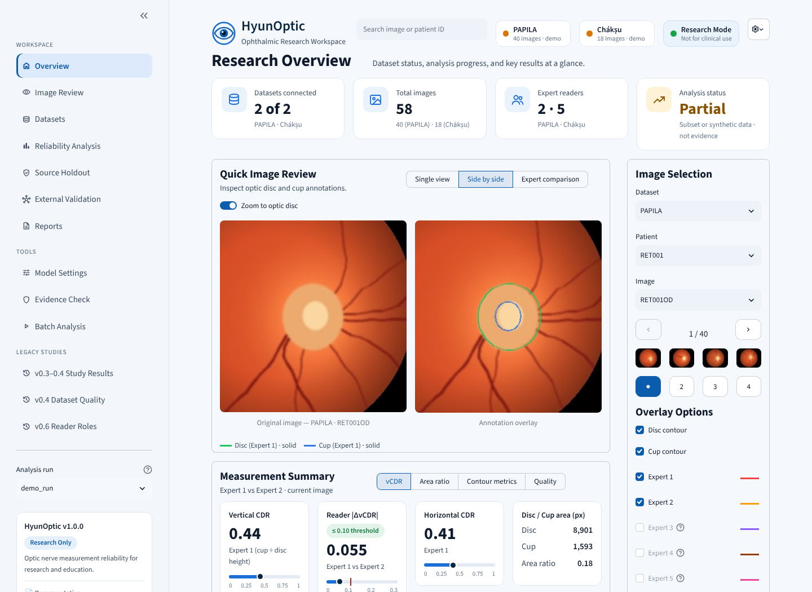
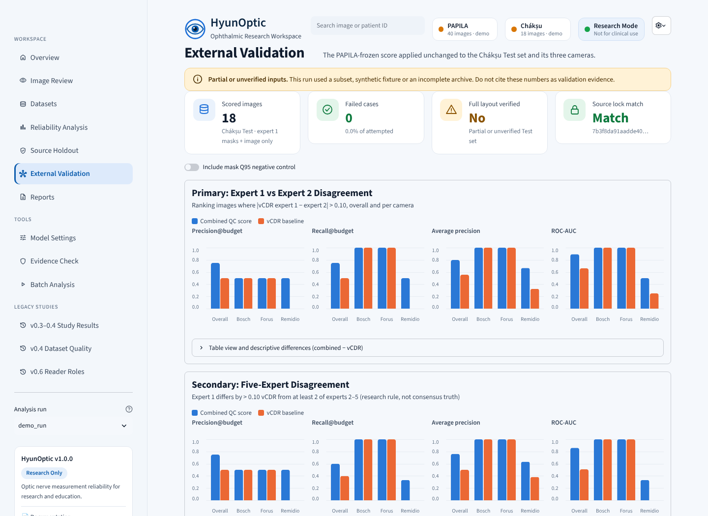

# HyunOptic

**Quantitative Optic Nerve Measurement & Reliability Validation**

**Status: v1.1.0 software release (2026-10-24).** A multi-page research workspace app now covers dataset integrity, image review, reliability, source-holdout and external-validation results, reports and evidence export. The full research chain — PAPILA inventory, development-only model freeze, patient-disjoint source holdout, Chákṣu Test five-reader preflight, external analysis, evidence gate and HTML report — runs with one command. All code is tested with synthetic data in GitHub Actions; **the complete real PAPILA/Chákṣu study has not yet been executed**, so no real-data result exists in this repository. **No PAPILA-wide or clinical validation, diagnostic performance, or novel uncertainty-detection result is claimed.**

> Research/education only. **NOT for clinical use, glaucoma diagnosis, or patient-specific care.**

HyunOptic is an independent medical imaging research software project intended to explore the **reliability and reproducibility of optic disc/cup measurements**, rather than to produce medical diagnoses.

## Quick start

On Python 3.10+ (Python 3.12 recommended):

```bash
python -m venv .venv
# Activate the environment before running the commands below.
python -m pip install -e ".[ui,dev]"
pytest -q
streamlit run app.py
```

With no dataset connected, the workspace shows a **synthetic geometry demo** that uses no patient images.

Windows PowerShell instructions, PAPILA file layout and CLI examples: **[Getting Started](docs/GETTING_STARTED.md)**.

## v1.1.0 — research workspace app



`streamlit run app.py` opens a multi-page workspace:

| Page | What it shows (only from your local data and run outputs) |
|---|---|
| **Overview** | Connected datasets, analysis status, quick image review with measurement summary, latest run steps and key results |
| **Image Review** | PAPILA (2 experts) or Chákṣu Test (5 experts) images; single, side-by-side and expert-comparison overlays (colour **and** line style per expert); brightness/contrast for display only; vCDR, area ratio, Dice, candidate features, frozen combined score; perturbation sensitivity; JSON/PNG export |
| **Datasets** | Dataset locations, counts, integrity checks (archive SHA-256, layout, annotation readability, five-reader masks) with timings and a local history |
| **Reliability Analysis** | Precision/recall at the review budget, AP, ROC-AUC with deltas against the vCDR baseline, precision–recall curves, partition comparison, disagreement distribution, patient bootstrap interval |
| **Source Holdout** | PAPILA validation/holdout results, patient split, bootstrap, content/inventory/model hashes |
| **External Validation** | Chákṣu Test results overall and by camera (primary and five-reader secondary endpoints), lock match, candidate-feature shift box plots |
| **Reports** | Preview/download aggregate files, regenerate the HTML report, evidence-package readiness and ZIP export (per-image files excluded) |
| **Tools** | Model lock inspection (read-only), evidence-gate check, Batch Analysis that runs `hyunoptic-pipeline` with live progress |

**Nothing is invented.** Before a run exists, result pages show an empty state rather than placeholder numbers; any partial, subset or synthetic run carries a warning banner. The search box jumps to an image or patient ID. Display settings (text size, high-contrast contours, dashed cup outline, line thickness) are under the gear icon.

Try it without the real datasets:

```bash
hyunoptic-demo-data --output-dir demo_data      # procedurally drawn, clearly marked SYNTHETIC
streamlit run app.py                            # Datasets → set the two demo paths → Batch Analysis
```

Demo data is far smaller than the published datasets and carries a `SYNTHETIC_DEMO_DATA.txt` marker, so its results are always labelled partial and must never be cited. Workspace settings and history are stored locally in `.hyunoptic/` (set `HYUNOPTIC_WORKSPACE` to move it).



## v1.0.0 — run the whole study with one command

```bash
hyunoptic-pipeline --papila-root /path/to/PAPILA \
  --papila-zip /path/to/PAPILA.zip --chaksu-test-zip /path/to/Chaksu/Test.zip \
  --output-dir reports/v1 --verify-pixels --strict
```

- Runs archive identity → PAPILA inventory → development-only freeze → PAPILA validation/holdout → Chákṣu all-five-reader preflight → Chákṣu external test → evidence gate → **aggregate-only `report.html`**, into one new folder.
- Every step is recorded as `passed`, `incomplete` (ran on partial/unverified data), `failed` or `skipped` in `pipeline_manifest.json`, with SHA-256 of shareable outputs and a list of local-only files. Synthetic or partial data never shows as `passed`.
- Omit `--chaksu-test-zip` for a PAPILA-only run. `hyunoptic-report` rebuilds the HTML report from existing aggregate JSON files.
- The HTML report is self-contained, works offline, escapes all text, never renders per-case rows or file names, and writes PASS/FAIL as words (not colour only).
- **Accessibility (plan F09):** the Streamlit viewer has a *Display & accessibility* panel with text size, high-contrast yellow/blue contours, dashed cup vs solid disc outline, and line thickness.
- The manual GitHub Actions research workflow now also runs the PAPILA part of the pipeline and uploads only aggregate files.

Full instructions, exit codes and the remaining researcher steps: **[v1.0 runbook](docs/V10_RUNBOOK.md)**.

## Run PAPILA locally

1. Obtain [PAPILA](https://figshare.com/articles/dataset/PAPILA/14798004) under the distributor's stated terms.
2. Extract the dataset, keeping `PAPILA_DBv1/FundusImages/` and `PAPILA_DBv1/ExpertsSegmentations/Contours/`.
3. Use the sidebar in the Streamlit app or run:

```bash
hyunoptic --papila-root /path/to/PAPILA_DBv1 --image-id RET001OD --output reports/RET001OD.json
```

**No images or clinical dataset files are bundled or uploaded by the tool.** PAPILA format support was based on the dataset descriptor and file convention; running against the complete original archive is still required.

## Remaining research work

1. Running `hyunoptic-pipeline` on the complete original PAPILA and Chákṣu archives and reporting the predeclared outcomes without holdout tuning (software ready; not yet executed).
2. Testing anatomical/spatial perturbations and stronger literature-supported reference-free baseline methods.
3. Independent review of the real-data evidence package, including null or negative results.
4. Failure-mode, reproducibility and subgroup analyses using real data.
5. English research report, poster and PhD portfolio presentation.

**Research question:** Can a reference-free QC score better prioritize measurements that will disagree substantially with an independent expert at a fixed expert-review budget? This remains an untested hypothesis; prior literature already addresses segmentation, CDR and uncertainty.

## Project documentation

- [Korean research plan](docs/PROJECT_PLAN_KO.md)
- [English research protocol](docs/RESEARCH_PROTOCOL_EN.md)
- [Installation, data format and methodology](docs/GETTING_STARTED.md)
- [v0.2 sensitivity and exploratory research protocol](docs/V02_UNCERTAINTY_PROTOCOL.md)
- [v0.3 patient-disjoint internal research protocol](docs/V03_PATIENT_SPLIT_PROTOCOL.md)
- [v0.4 dataset quality and permutation null protocol](docs/V04_DATA_QUALITY_AND_NULL_PROTOCOL.md)
- [v0.5 reproducible official dataset run](docs/V05_REPRODUCIBLE_REAL_DATA_RUN.md)
- [v0.6 reader-role robustness and measurement agreement](docs/V06_READER_ROLE_ROBUSTNESS.md)
- [v0.7 PAPILA-to-Chákṣu frozen external-domain protocol](docs/V07_EXTERNAL_VALIDATION_PROTOCOL.md)
- [v0.8 external integrity and statistical reporting protocol](docs/V08_EXTERNAL_INTEGRITY_PROTOCOL.md)
- [v0.9 five-reader secondary sensitivity protocol](docs/V09_FIVE_READER_SENSITIVITY_PROTOCOL.md)
- [v1.0 release candidate data identity and external validation checklist](docs/V10_RELEASE_CANDIDATE_CHECKLIST.md)
- [v1.0-rc2 research evidence-package readiness guide](docs/V10_RC2_EVIDENCE_REVIEW.md)
- [v1.0-rc3 PAPILA source-mask holdout and evidence chain](docs/V10_RC3_SOURCE_MASK_HOLDOUT.md)
- [v1.0.0 one-command runbook, HTML report, accessibility and v1.1 workspace app](docs/V10_RUNBOOK.md)

## Research dataset information

| Dataset | Planned role | Source |
|---|---|---|
| PAPILA | Two-expert imaging and measure-comparison development | [2022 Scientific Data paper](https://doi.org/10.1038/s41597-022-01388-1) · [Figshare](https://figshare.com/articles/dataset/PAPILA/14798004) |
| Chákṣu | Future external reader/device reliability testing | [Scientific Data paper](https://doi.org/10.1038/s41597-023-01943-4) |
| Harvard-GDP | Optional later OCT/RNFL research | [Research repository](https://github.com/Harvard-Ophthalmology-AI-Lab/Harvard-GDP) |

Respect the individual dataset license, consent and redistribution restrictions. Do not place raw eye images or private clinical information in this public repo. No clinical deployment is permitted.

## Technology

Python · NumPy · Pillow · Streamlit · pytest. Research dataset ingestion uses local files; no automatic downloads, API keys or cloud upload endpoints.

## Release history

Earlier releases, oldest first. Each section describes what that release added.

### Implemented (v0.1)

- Local PAPILA image/annotation discovery, with **exact** expert contour filenames.
- Handles both eyes grouped by the same patient ID (`OD` = right eye; `OS` = left eye).
- Loads optic **disc** and **cup** contour coordinates from independent experts (`exp1`/`exp2`).
- Converts contours to full-resolution masks; measures **vertical**, **horizontal**, and **area** cup-to-disc ratios.
- Compares two readers' vCDR and disc/cup **Dice** overlap (retrospective comparison).
- Flags out-of-bounds annotations and inconsistent cup/disc geometry.
- Streamlit image overlay, optic disc crop, comparison table, JSON and PNG export.
- Offline CLI and synthetic data tests; GitHub Actions unit-test workflow for Python 3.10/3.12.

**The current app displays existing expert annotations; it does not yet segment new images autonomously.** Dice is computed with both experts present and is **not** a prospective reference-free QC score.

### Added in v0.2 (implemented as research prototypes)

- Reproducible candidate-only vertical-span perturbation simulation (independent/shared log-normal factors).
- Covariance-aware delta-method error propagation and empirical simulated vCDR variance.
- Simulated 2.5–97.5% range and Q95 absolute perturbation-induced vCDR change, **not medical confidence intervals or diagnostic probabilities**.
- Streamlit sensitivity control panel and candidate-only sensitivity export in JSON.
- Exploratory PAPILA batch CLI with JSON/CSV export, top-20%-review ranking, retrospective independent-reader comparison, and patient-cluster bootstrap for the **dataset-level** mean difference.
- No claimed calibration, diagnostic accuracy, external validation, novelty or superiority.

See [v0.2 uncertainty and evaluation protocol](docs/V02_UNCERTAINTY_PROTOCOL.md). The implemented perturbation model uses **assumed** correlated scale changes, not observed expert error. A proper patient-disjoint evaluation and Chákṣu external test remain future work.

Example batch command:

```bash
hyunoptic --papila-root /path/to/PAPILA_DBv1 --batch --output reports/audit.json --csv-output reports/audit.csv
```

### Added in v0.3 — patient-disjoint internal benchmark (CLI)

- Reference-free **candidate-only** image/contour features: cup-outline isoperimetric roughness and local grayscale boundary contrast, alongside v0.2 Q95 and vCDR comparators.
- Reproducible 60/20/20 **patient-level** development/validation/internal holdout partition (both eyes of one patient stay together).
- Fixed equal-weight combination of development-standardized candidate-only features; no fitting to or leakage of expert-2 labels.
- Precision and recall at a fixed 20% expert-review budget against retrospective **inter-reader vCDR disagreement**, not glaucoma outcomes.
- Patient-cluster bootstrap interval for paired precision difference versus v0.2 baseline, including possible null/negative results.
- JSON/CSV case reports, protocol hash, skipped-case trace, and regression tests that alter expert-2 labels without altering candidate-only scores.

**Why v0.3 matters:** with fixed log-scale perturbation settings, the previous Q95 sensitivity score is effectively proportional to candidate vCDR. v0.3 treats it as a *baseline*, not as newly demonstrated evidence of annotation unreliability.

Run with lawfully downloaded local PAPILA files:

```bash
hyunoptic-study --papila-root /path/to/PAPILA_DBv1 --output reports/v03.json --csv-output reports/v03.csv
```

Details: [v0.3 patient split / evaluation protocol](docs/V03_PATIENT_SPLIT_PROTOCOL.md).

**Scientific limit:** Candidate scoring logic and synthetic tests are implemented; no actual full PAPILA trial, superiority claim or independent external Chákṣu test is completed. The v0.3 benchmark is exploratory, not a glaucoma diagnostic tool. The interactive Streamlit viewer remains focused on the v0.2 measurement and sensitivity screens.

### Added in v0.4 — data integrity and null controls

- `hyunoptic-inventory` command checks PAPILA image/patient/annotation counts, bilateral pairing, image sizes, missing contours, coordinate bounds, and duplicate-like annotations without copying source images.
- **Dataset Quality** Streamlit page shows issues from your own local inventory JSON; it displays no example clinical measurements unless you load a file.
- The `hyunoptic-study` output now includes an **exploratory patient-group permutation null** for v0.2 Q95 and combined candidate score alongside the patient-cluster bootstrap. It maintains within-patient eye grouping and does not use reader 2 for ranking.
- Version 0.4 is still **not validated on the complete real PAPILA archive or Chákṣu external dataset**; no clinical correctness or performance improvement has been shown.

```powershell
hyunoptic-inventory --papila-root "D:\\datasets\\PAPILA_DBv1" --output reports\\inventory_v04.json --strict-full --verify-pixels
hyunoptic-study --papila-root "D:\\datasets\\PAPILA_DBv1" --output reports\\study_v04.json --csv-output reports\\study_v04.csv
streamlit run app.py
```

See [v0.4 research protocol](docs/V04_DATA_QUALITY_AND_NULL_PROTOCOL.md). Both **Study Results** and **Dataset Quality** are available in the Streamlit multipage sidebar.

### v0.5 — run the official public dataset reproducibly

**New local commands:**
- `hyunoptic-download` — opt-in download from official Figshare article metadata, integrity validation and safe ZIP extraction.
- `hyunoptic-reproduce` — strict archive completeness gate, internal measurement-reliability study, run provenance and data-derived research summary.
- **Manual GitHub Actions run** (requires explicit dataset processing consent) — process official archive on an ephemeral runner and upload **aggregate report only**. Does not run automatically.

```powershell
# Review https://figshare.com/articles/dataset/PAPILA/14798004 first.
hyunoptic-download --archive "D:\\datasets\\PAPILA.zip" --extract-to "D:\\datasets\\PAPILA" --accept-dataset-terms
hyunoptic-reproduce --papila-root "D:\\datasets\\PAPILA" --output-dir reports\\v05 --verify-pixels
```

The gated run generates `inventory.json`, `study.json`, `case_metrics.csv`, `run_manifest.json` and `research_summary.md`. Case-level outputs should not be publicly posted without careful privacy and dataset-license review.

**No actual complete-PAPILA study results have been claimed in this repository.** Download, extraction and study execution are implemented and tested with **synthetic fixtures only**; the real 563 MB archive remains to be run. See [v0.5 reproducible real-data protocol](docs/V05_REPRODUCIBLE_REAL_DATA_RUN.md).

### v0.6 — robustness to expert-reader choice

The two ophthalmologists can disagree about cup/disc boundaries. v0.6 now runs a symmetrical, patient-disjoint **expert-role sensitivity** study to test whether a candidate-only QC score changes when exp1 and exp2 exchange roles.

**Added:** tie-aware average precision (AP) and ROC-AUC for inter-reader **disagreement**, stable top-20% review-overlap, tie-aware Spearman ranking, signed expert vCDR bias and exploratory Bland–Altman limits with patient-cluster bootstrap intervals. AP/AUC do **not** refer to glaucoma diagnosis. No ground-truth disease outcomes or external results have been claimed.

```powershell
hyunoptic-reader-check --papila-root "D:\\datasets\\PAPILA" --output-dir reports\\reader_v06
streamlit run app.py
```

In Streamlit select **Reader Roles** and upload `reader_symmetry.json`. The output folder includes `reader_role_summary.md` for an **aggregate-only, data-derived** research summary and private per-case files that should not be published without license/privacy review. A complete PAPILA inventory is required by default; `--allow-partial` is for synthetic/incomplete exploratory fixtures only.

**Scientific gate:** automated synthetic tests are NOT a successful real-PAPILA experiment. The original 488-image study and Chákṣu external evaluation still must be executed and independently checked. Read the [v0.6 robustness protocol](docs/V06_READER_ROLE_ROBUSTNESS.md).

### v0.7 — PAPILA-frozen → Chákṣu Test external-domain research

**New shared mask-feature protocol:** PAPILA stores expert-drawn contour coordinates, whereas Chákṣu provides five experts' *binary masks*. v0.7 converts PAPILA expert-1 contours to masks before feature extraction, then applies **identically defined mask-based features** to the original Chákṣu Test.zip. The earlier v0.6 polygon-score results are a separate experiment and **cannot** be compared directly to v0.7 scores.

- `hyunoptic-external freeze`: fit a mask-feature normalization model **only on the patient-disjoint PAPILA development partition**, then write an integrity-hashed JSON lock. Independent expert labels and external Test data do not enter scoring.
- `hyunoptic-external test`: read original Chákṣu **Test.zip in place**, without expanding its TIFF masks to disk; verify all five expert mask paths but score expert 1 only, using expert 2 exclusively for retrospective reference disagreement.
- Strict external gate: 336 Test images (**Bosch 41 / Forus 31 / Remidio 264**) and complete readable mask pairs are required. The `--allow-partial` option exists **only for synthetic fixtures/partial exploratory runs** and marks results invalid as full external evidence.
- Aggregate scores and camera-specific metrics: precision/recall at a fixed 20% review budget, Average Precision (AP), and ROC AUC, **all for reader disagreement and NOT glaucoma diagnosis**.
- Streamlit **External Validation** page reads `external_aggregate.json` and displays no results before you supply data.

**No actual original Chákṣu Test archive was executed during v0.7 implementation.** GitHub CI tests only verify synthetic-image/ZIP parsing, frozen configurations, missing-label checks and method reproducibility. Results are not invented and no clinical claims are supported.

```powershell
# First obtain and verify PAPILA under its published research/data terms:
hyunoptic-external freeze --papila-root "D:\\datasets\\PAPILA" --output "reports\\v07\\papila_frozen_mask_model.json"

# Separately obtain the original Chákṣu Test.zip from Figshare:
hyunoptic-external test --model-lock "reports\\v07\\papila_frozen_mask_model.json" --chaksu-test-zip "D:\\datasets\\Chaksu\\Test.zip" --output-dir "reports\\v07\\external"

streamlit run app.py
```

Read [v0.7 frozen external-domain study protocol](docs/V07_EXTERNAL_VALIDATION_PROTOCOL.md) for design, assumptions, access terms, camera stratification and important limitations.

### v0.8 — all-five-reader ZIP preflight and descriptive score comparison

The official Chákṣu Test archive includes 336 images (Bosch 41, Forus 31, Remidio 264) and independent optic disc/cup masks from five experts. A complete *filename count* alone cannot guarantee that all ten masks for each image are decodable. v0.8 adds a real-payload **preflight requiring all five readers** before any full external-domain evaluation is accepted.

- `hyunoptic-chaksu-audit` scans every selected original Test image, all ten expert masks, image-to-mask resolution agreement, nonempty binary structure, cup/disc geometry, published camera dimensions, and suspicious ZIP entries — with no full extraction.
- Handles archive name aliases `Test`, `Test set`, `Test_set`, and `Remidio`/`Remedio`.
- Reports aggregate numbers in `audit_aggregate.json` and locally restricted failure identifiers in `audit_private_errors.json`.
- Unqualified external evaluation rechecks the all-five-reader integrity gate. `--allow-partial` flags a result as exploratory/unverified.
- Frozen combined-score performance is compared with vCDR-only baseline using same-case **descriptive deltas** in precision, recall, AP and ROC-AUC. No p-value, independence assumption or clinical accuracy claim is made.

```powershell
git pull
python -m pip install -e ".[ui,dev]"
hyunoptic-chaksu-audit --chaksu-test-zip "D:\\datasets\\Chaksu\\Test.zip" --output-dir reports\\v08\\audit --strict
hyunoptic-external freeze --papila-root "D:\\datasets\\PAPILA" --output reports\\v08\\papila_frozen_mask_model.json
hyunoptic-external test --model-lock reports\\v08\\papila_frozen_mask_model.json --chaksu-test-zip "D:\\datasets\\Chaksu\\Test.zip" --output-dir reports\\v08\\external
```

**No original full PAPILA/Chákṣu performance result has been obtained in this release.** The implemented compatibility and statistical-reporting checks were tested using synthetic data, not a real clinical cohort.

See [v0.8 external integrity protocol](docs/V08_EXTERNAL_INTEGRITY_PROTOCOL.md).

### v0.9 — four-reference secondary sensitivity without label leakage

Chákṣu supplies five independent specialists' disc/cup masks, but previous external analysis used only expert 1 and expert 2. v0.9 **keeps expert1↔expert2 as the unchanged primary endpoint** and adds a clearly labelled **secondary** five-reader analysis.

- Compute the frozen candidate quality score using only the fundus image + expert 1 masks. The four independent readers' masks are NOT feature inputs.
- **After candidate scoring**, calculate vCDR from expert 2–5 masks, four expert1-to-peer differences, and all 10 unordered expert pairs.
- Secondary research flag: expert 1's vCDR differs by more than **0.10** from **at least 2 of 4** other experts. This is **not medical consensus, disease truth or an accepted clinical threshold**.
- Evaluate both primary and secondary disagreement rankings under the same previously frozen review budget, with camera-specific summary tables and null/undefined metrics shown honestly.
- Read-only **External Validation** Streamlit dashboard displays secondary outcomes only when supplied with an actual v0.9 `external_aggregate.json` report.
- No outcome-based model retraining, no independent-patient claim on unidentified Chákṣu images, and no clinical classification.

Use the same `hyunoptic-external freeze` and `hyunoptic-external test` commands described above, with new output paths (e.g. `reports/v09/`). The generated `external_summary.md` documents both primary and secondary analyses. Private case-level outputs remain local.

**No original full PAPILA/Chákṣu study result has been generated.** Only synthetic-image/ZIP software testing has been completed; numerical research benefit is unknown.

See [v0.9 five-reader sensitivity protocol](docs/V09_FIVE_READER_SENSITIVITY_PROTOCOL.md).

### v1.0 release candidate — source identity and unlabeled camera shift

**This is a software release candidate, NOT a completed real-data or clinical study.**

- `hyunoptic-verify-sources`: compute SHA-256 for **local PAPILA.zip / Chákṣu Test.zip without uploading anything**, and compare with checksums published by an independent open-source dataset index. A match confirms identical archive bytes to that reference, **not publisher signature, medical annotation accuracy or patient identity**.
- `hyunoptic-external test`: on top of unchanged v0.9 primary and secondary reader-disagreement analyses, report **candidate-only camera-domain-shift diagnostics** using PAPILA development mean/SD locked *before* external testing.
- The **External Validation** viewer can display aggregate per-camera source-standardized shift and existing descriptive disagreement rankings only when you upload a genuine local report.
- Automated CI tests include reference-checksum streaming, source-label separation, malformed inputs and no fabricated UI results.

```powershell
git pull
python -m pip install -e ".[ui,dev]"

# Both raw archives must be acquired under the source terms in advance.
hyunoptic-verify-sources --papila-zip "D:\\datasets\\PAPILA.zip" --chaksu-test-zip "D:\\datasets\\Chaksu\\Test.zip" --output reports\\v10\\sources.json --require-reference-match
```

For source freezing, Test preflight, test execution and the exact acceptance checklist, see **[v1.0-rc1 reproducibility guide](docs/V10_RELEASE_CANDIDATE_CHECKLIST.md)**.

**Research caveat:** The actual complete PAPILA/Chákṣu archives remain unexecuted in the current working environment. Prior 107+ CI tests and the new synthetic tests prove software behavior only; they do **not** demonstrate superior clinical/measurement outcomes or scientific novelty.

### v1.0.0rc2 — verify that real research artifacts belong to one experiment

The newest release candidate does **not** claim a new scientific result. It adds an evidence-package checklist that combines five previously separate tools:

- `hyunoptic-evidence` checks that the **official-source ZIP reference hashes, complete PAPILA inventory, untouched PAPILA development model lock, all-five-reader Chákṣu Test preflight, and external aggregate** are present and internally consistent.
- Rejects mismatching frozen-lock SHA-256, partial-source scoring, incomplete expert masks, and incomplete Test results when run with `--strict`.
- Labels **scientific validity** and **clinical accuracy** as *not established*, **even when all artifact checks pass**. Synthetically constructed JSONs can satisfy metadata checks, so the gate is not independent certification.
- The Chákṣu manifest now counts **known possible repeated-patient image groups** from eligible filename patterns, without pretending all patients can be identified or building invalid independent-patient confidence intervals.

```powershell
git pull
python -m pip install -e ".[ui,dev]"
hyunoptic-evidence --help
```

Read [v1.0-rc2 evidence-package execution guide](docs/V10_RC2_EVIDENCE_REVIEW.md) for complete Windows commands and provenance limitations.

**Not yet done:** The complete official PAPILA/Chákṣu archives have not been processed in the agent runtime. Clinical performance and any improvement over vCDR-only ranking remain unproven.

### v1.0.0rc3 — test on PAPILA with the EXACT external mask score

**Addresses a critical scientific gap:** before rc3, the source study used older polygon features while the Chákṣu external analysis used a distinct mask-based score. Results for the two models cannot be compared directly. The new `hyunoptic-source-check` evaluates exactly the **same frozen mask-feature scoring family** as the external evaluator on PAPILA's patient-disjoint **validation and holdout** patients.

- Use **PAPILA exp1** image/contour masks for candidate scores; load **exp2 only after scoring** for retrospective vCDR disagreement labels. No development reader-2 outcomes enter the source evaluation.
- Evaluate frozen combined score, untrained Q95 and vCDR baselines using review-budget precision/recall, AP, ROC-AUC and exploratory *patient-cluster* bootstrap intervals, clearly internal only.
- Freeze now stores a streaming **SHA-256 of actual fundus/contour file contents**, not merely names and file lengths. Source holdout rejects altered data even if a replacement file is exactly the same size. Previously frozen model-lock JSONs need to be regenerated for the rc3 internal evaluation.
- The `hyunoptic-evidence` gate now requires **six artifacts**, including the PAPILA `source_aggregate.json` and matching content hash/source model lock; no package can pass the metadata readiness gate without the internal source comparison.
- Streamlit **Source Holdout** page reads the real local aggregate JSON; no synthetic performance scores are displayed by default.

```powershell
git pull
python -m pip install -e ".[ui,dev]"
hyunoptic-external freeze --papila-root "D:\\datasets\\PAPILA" --output "reports\\rc3\\papila_mask_lock.json"
hyunoptic-source-check --papila-root "D:\\datasets\\PAPILA" --model-lock "reports\\rc3\\papila_mask_lock.json" --output-dir "reports\\rc3\\source_holdout"
```

Read the [rc3 source-mask holdout and content-fingerprint protocol](docs/V10_RC3_SOURCE_MASK_HOLDOUT.md) for complete source → external → evidence gate instructions.

**Software tested with synthetic assets only.** Real PAPILA and Chákṣu evaluation results, clinical safety, and actual score superiority have **not** been established.

## License

A software license has **not yet been selected**. Dataset licenses and code licenses are separate; do not assume the dataset is re-licensed by this repository.
