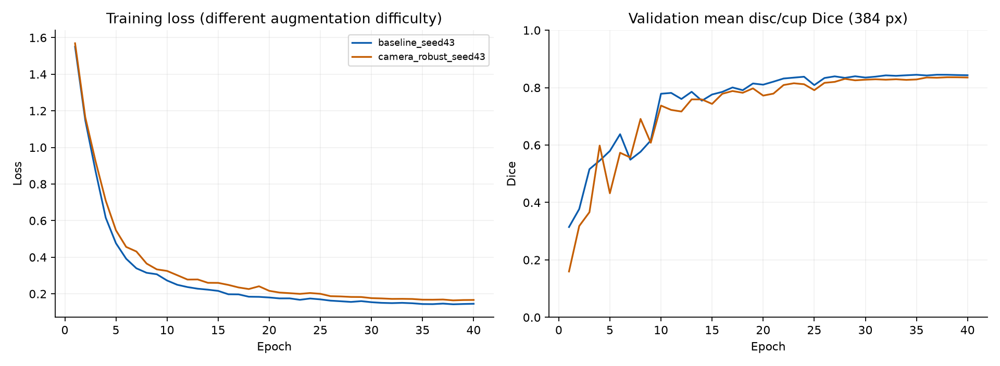
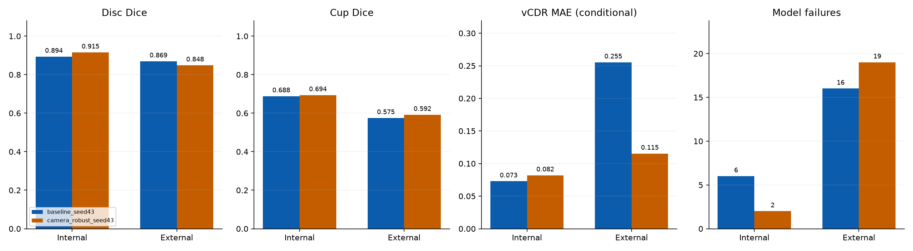

# One photometric-remediation follow-up — 2026-10-25

One actual 40-epoch training run tests an image-only photometric-domain hypothesis after the [three-seed experiment](../2026-10-25-seed-stability/README.md). All results are **exploratory**, using already inspected cohorts. The pretraining protocol fixes seed43/split42, all original settings except the explicitly selected `camera_robust_v2` photometry, and a one-run budget. No outcome-driven second attempt, seed selection, postprocess change or source-mask repair.

## Diagnosis and change

The prior seed43 model has 16 external empty-cup failures: six had no raw cup and ten lost raw cup pixels during existing disc-component filtering. On selected high/low-error diagnostic cases, cup-component-only filtering had mixed effects and did not resolve contiguous overextension. These selected cases are not dataset performance estimates.

Image-only samples (32 PAPILA development;16 per external camera) have mean red/green ratios 2.903 / Bosch1.512 / Forus2.390 / Remidio1.359. This suggests a color/exposure mismatch; it does not prove causality. See diagnostic JSON and scripts for exact sampling/masking definitions.

`camera_robust_v2` widens brightness/contrast to 0.7–1.3, adds independent RGB gains0.65–1.35 and gamma0.7–1.5, preserves black pixels and leaves targets unchanged by photometry. Extra draws use a separate generator (seed1000046), preserving the legacy main RNG for shuffle/spatial transforms. The default `baseline_v1` behavior/config remains compatible. Model/loss/inference/postprocessing are unchanged. General photometric-jitter semantics: [official PyTorch documentation](https://docs.pytorch.org/vision/stable/generated/torchvision.transforms.ColorJitter.html); the bounded policy here is explicitly defined by this project.

## Actual original-resolution results, expert1

New selected epoch: **38**; validation mean disc/cup Dice **0.8362**. Same source/split hashes and development292/validation98/holdout98 images; 146/49/49 patients.

| Model | Evaluation | Dice n | Disc Dice | Cup Dice | vCDR n | vCDR MAE | Model failures | Reference failures |
|---|---|---:|---:|---:|---:|---:|---:|---:|
| baseline_seed43 | internal | 98 | 0.8936 | 0.6883 | 92 | 0.0728 | 6 | 0 |
| baseline_seed43 | external | 311 | 0.8693 | 0.5749 | 295 | 0.2553 | 16 | 25 |
| camera_robust_seed43 | internal | 98 | 0.9154 | 0.6939 | 96 | 0.0820 | 2 | 0 |
| camera_robust_seed43 | external | 311 | 0.8484 | 0.5915 | 292 | 0.1153 | 19 | 25 |

Dice/MAE are per-image means. Internal total98 and external total336 are unchanged. Invalid predictions remain in Dice when masks exist; undefined vCDR is excluded from conditional MAE. The same25 external reference failures are retained. Expert2 sensitivity and errors>0.10 are in comparison_metrics.csv and aggregate reports.





## Paired and failure-aware descriptive comparisons

| Evaluation | Common measurable n | Baseline paired MAE | New paired MAE | Baseline invalid=1 penalty | New invalid=1 penalty |
|---|---:|---:|---:|---:|---:|
| internal | 92 | 0.0728 | 0.0776 | 0.1295 | 0.1007 |
| external | 284 | 0.2553 | 0.1167 | 0.2936 | 0.1693 |

Paired MAE uses identical cases for both models, not the whole cohort. The separate penalty assigns1 to model-invalid predictions over all reference-valid cases (98 internal/311 external). This is an arbitrary predeclared research summary, **not measured MAE, clinical utility, or a confidence estimate**. It prevents coverage changes being hidden behind conditional MAE. No private case IDs are published.

## Outcome: mixed, not promoted to the default

External cup Dice rises from0.5749 to0.5915, and paired vCDR MAE on the same284
measurable images falls from0.2553 to0.1167. However, external disc Dice drops
from0.8693 to0.8484 and model failures rise from16 to19; the reference failures
remain25. Internal paired vCDR MAE rises from0.0728 to0.0776, despite fewer
internal model failures (6 to2). The predeclared external rule is **not met**.
This is evidence of a tradeoff from one policy/run, not a complete fix or
established robustness. Keep `baseline_v1` as default and expose the new policy
only as an explicit experimental training option.

## Predeclared decision and limitations

- External rule met: **False** (fewer than16 model failures, vCDR MAE<0.25531009 and Cup Dice>=0.55487019).
- Internal tradeoff flag: **False** (disc/cup drop>0.02 or model failures>6).
- These descriptive thresholds were recorded before training; no statistical significance or clinical interpretation is implied. One new run does not establish seed stability, causal benefit or generalization. The seed43 comparator was deliberately chosen after prior failure diagnosis, not as an untouched control. See the original three-seed range for context.
- Human annotations and pixel-span conventions can differ across datasets. Original reference masks, measurement definitions and failure gates were preserved. Full five-reader structural verification remains false; do not claim complete336-image performance.
- GPU nll_loss2d nondeterminism warning remains; fixed seeds do not guarantee bitwise-repeatable weights. No clinical/diagnostic claim.

## Evidence and reproduction

Protocol/code hashes, diagnostic aggregate JSON, each model's config/history/bundle manifest, aggregate results and CSV comparisons are included. New weights SHA256: `1430f6c9192cbf0dbacdae9fcbad441ef23be2e6acbb21d923d310b35aca6cc4`. Original images, masks, weights, split identifiers and per-case rows remain local. Bundle manifests describe original local models and cannot be loaded from this aggregate-only directory.

Use a fresh checkout of protocol.code_commit and the [baseline environment/source instructions](../2026-10-25-real-data-baseline/REPRODUCE.txt). Obtain [PAPILA v2 (GPL3.0+)](https://doi.org/10.6084/m9.figshare.14798004.v2), [Kovalyk et al.2022](https://doi.org/10.1038/s41597-022-01388-1), and [Chákṣu v2 (CC BY4.0)](https://doi.org/10.6084/m9.figshare.20123135.v2), [Kumar et al.2023](https://doi.org/10.1038/s41597-023-01943-4), under their terms.

```powershell
$env:OMP_NUM_THREADS='4'
$env:MKL_NUM_THREADS='4'
$env:CUBLAS_WORKSPACE_CONFIG=':4096:8'
hyunoptic-seg train --papila-root data/PAPILA --output models/new_photometric_run --image-size 384 --epochs 40 --batch-size 4 --lr 0.001 --weight-decay 0.0001 --base-channels 16 --depth 4 --seed 43 --split-seed 42 --device cuda --photometric-policy camera_robust_v2
hyunoptic-seg evaluate --bundle models/new_photometric_run --papila-root data/PAPILA --exploratory-rerun
hyunoptic-seg evaluate --bundle models/new_photometric_run --chaksu-test-zip data/Chaksu_Test.zip
```

The actual orchestration scripts are audit records requiring the original local bundles, completion files and private evaluation rows. Copying them alone into a public checkout is insufficient; the CLI commands independently reproduce a numerical experiment. The collector independently recomputes arithmetic, verifies unchanged originals and stages evidence before publishing. `evidence_manifest.json` hashes every other public file. These local checks are not independent scientific certification.
