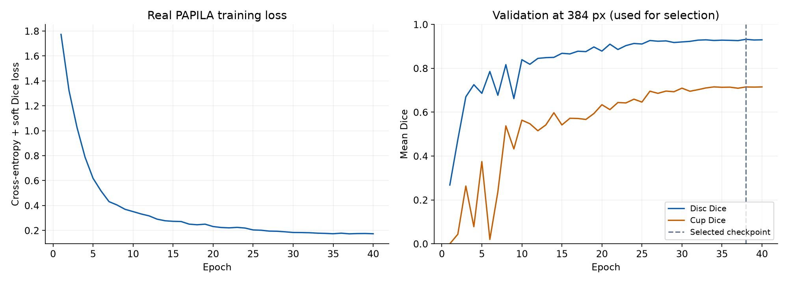
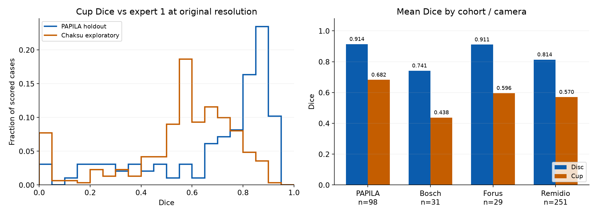

# Actual real-data segmentation baseline — 2026-10-25

This records an executed PyTorch small U-Net experiment, not the separate
candidate-QC study or clinical validation. [Full HTML report](index.html)
(download/open locally), [CSV metrics](metrics.csv), [reproduction commands](REPRODUCE.txt).

## Data and training

- [PAPILA v2](https://doi.org/10.6084/m9.figshare.14798004.v2), GPL 3.0+;
  [Kovalyk et al. (2022)](https://doi.org/10.1038/s41597-022-01388-1).
  488 images / 244 patients; patient-disjoint development 292/146,
  validation 98/49, holdout 98/49 (images/patients).
- [Chákṣu v2](https://doi.org/10.6084/m9.figshare.20123135.v2), CC BY 4.0;
  [Kumar et al. (2023)](https://doi.org/10.1038/s41597-023-01943-4).
  Published Test archive: 336 images, five readers, three camera brands.
- Whole-image letterbox 384 px, 3 classes, base channels 16, depth 4;
  40 epochs, AdamW lr 0.001, weight decay 0.0001, cosine schedule,
  batch 4, seed/split seed 42. Expert 1 targets only.
- Selected epoch **38** using validation mean disc/cup Dice **0.8235**
  at model resolution. Internal holdout was evaluated once after selection.
  Training and saving: **403.6 seconds** on RTX 3070 Laptop GPU.

## Results at original image resolution

| Evaluation / reference | Total images | Dice n | Disc Dice mean | Cup Dice mean | vCDR n | vCDR MAE |
|---|---:|---:|---:|---:|---:|---:|
| PAPILA holdout / expert 1 | 98 | 98 | 0.9140 | 0.6821 | 96 | 0.0777 |
| PAPILA holdout / expert 2 | 98 | 98 | 0.8891 | 0.6614 | 96 | 0.0791 |
| Chákṣu exploratory / expert 1 | 336 | 311 | 0.8154 | 0.5595 | 309 | 0.1904 |
| Chákṣu exploratory / expert 2 | 336 | 311 | 0.8206 | 0.5825 | 309 | 0.1631 |

Dice is overlap (higher is better); vCDR MAE is absolute ratio error (lower
is better), not glaucoma diagnostic accuracy. Internal expert-1 cup Dice
median is 0.7988; the lower mean reflects poor cases. Its patient-cluster
bootstrap 95% interval for the patient-weighted mean is 0.6210–0.7421.

### Failures and interpretation

- Internal: 2 invalid predicted geometries; their available masks remain
  in Dice, while undefined vCDR is excluded from the vCDR denominator.
- External: 25 reference-loading/containment failures and 2 invalid
  predicted geometries. All-five-reader preflight checked all 336 cases;
  311 were readable. A separate unexpected-resolution flag gives 26
  preflight errors/flags. Full structural verification is **false**.
  Original annotations were not silently repaired.
- [PR #2](https://github.com/HyunStudio/HyunOptic/pull/2) excludes 3,971 macOS
  metadata entries, including 295 image sidecars. The actual 336-case
  image/mask list was verified unchanged by that parser correction.
- Chákṣu is **exploratory**: it had already been inspected by this project's
  QC protocol, and patient linkage is insufficient for patient intervals.
  These scores do not establish performance across all published images.
- External scores are lower, especially for cup/vCDR. Additional experiments
  must retain this baseline and be labeled exploratory after holdout inspection.
- One seed and one training run; no superiority or clinical claims.
  CUDA nll_loss2d emitted a nondeterminism warning, so fixed seeds do not
  establish bitwise repeatability. GitHub CI tests use synthetic fixtures.

## Evidence and publication scope

`history.json`, `config.json`, `bundle_manifest.json`, `protocol.json`,
`execution_versions.json`, aggregate reports, environment, official-download
provenance and `REPRODUCE.txt` preserve the actual run. Training code commit:
`8aebd4cfdc8954678896c436321a22159afe1769`; external evaluation code:
`f423de717c05c6658ccda65ddeb6228e4bc63f8f`. Both are integrated in main at
`d0b0755298db2807fa9ccc8de4c93765fe252ebf`.

Selected weights SHA-256:
`8d7c01bad42fa6b8c4b6520b47558d37ebbe162e980561396edd552391be15ff`.
Raw images, annotations, per-case identifiers/results, split manifests and
model weights are excluded from this public directory. `bundle_manifest.json`
describes the original local bundle; this aggregate-only directory cannot be
loaded as a model bundle. One local extraction path was omitted from the
public download provenance. Generated SVG trailing whitespace was normalized for Git review. Archive hashes, plot geometry and numerical results are unchanged. `.gitattributes` preserves evidence bytes across checkouts.

`evidence_verification.json` records local arithmetic recomputation from private
case rows; the private rows are not published and this is not independent
scientific certification. `evidence_manifest.json` hashes all other files here.
