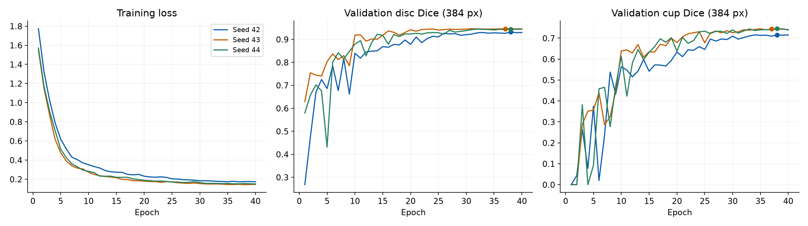
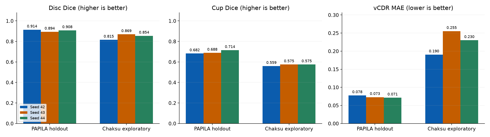

# Fixed-split training-seed stability — 2026-10-25

The user requested two additional seeds after the [seed-42 baseline](../2026-10-25-real-data-baseline/README.md). This is a **follow-up exploratory analysis**, including all three runs without choosing a winner from holdout/external performance.

Only training seed changed to 43 and 44. Split seed remains 42; identical patient grouping, source-content hash, 292 development / 98 validation / 98 holdout images, original 384 px U-Net, 40 epochs, batch 4, optimizer, schedule and augmentation. Each checkpoint was selected on validation only, and both new checkpoints were frozen before their follow-up evaluations. No product-code changes.

## Expert-1 original-resolution results

| Seed | Evaluation | Selected epoch | Dice n | Disc Dice | Cup Dice | vCDR n | vCDR MAE | Failures |
|---|---|---:|---:|---:|---:|---:|---:|---:|
| 42 | internal | 38 | 98 | 0.9140 | 0.6821 | 96 | 0.0777 | 2 |
| 42 | external | 38 | 311 | 0.8154 | 0.5595 | 309 | 0.1904 | 27 |
| 43 | internal | 37 | 98 | 0.8936 | 0.6883 | 92 | 0.0728 | 6 |
| 43 | external | 37 | 311 | 0.8693 | 0.5749 | 295 | 0.2553 | 41 |
| 44 | internal | 38 | 98 | 0.9076 | 0.7144 | 96 | 0.0714 | 2 |
| 44 | external | 38 | 311 | 0.8545 | 0.5750 | 310 | 0.2302 | 26 |





## Descriptive variation over three training seeds

| Evaluation | Metric | Mean ± sample SD | Min–max |
|---|---|---:|---:|
| internal | disc_dice | 0.9050 ± 0.0104 | 0.8936–0.9140 |
| internal | cup_dice | 0.6949 ± 0.0171 | 0.6821–0.7144 |
| internal | vcdr_mae | 0.0739 ± 0.0033 | 0.0714–0.0777 |
| external | disc_dice | 0.8464 ± 0.0279 | 0.8154–0.8693 |
| external | cup_dice | 0.5698 ± 0.0089 | 0.5595–0.5750 |
| external | vcdr_mae | 0.2253 ± 0.0327 | 0.1904–0.2553 |

Dice and MAE are means over scored images, not pooled-pixel scores. SD uses ddof=1 over the three run-level means. Three seeds on one fixed split measure only training-seed variation; these are not three independent cohorts and the SD is not a patient-population confidence interval. Denominators can differ with invalid predictions; compare them alongside each score. Expert-2 sensitivity and error >0.10 counts are in [per_run_metrics.csv](per_run_metrics.csv) and aggregate JSON.

## What this comparison establishes

On this fixed split, expert-1 cup Dice ranges from 0.6821 to 0.7144 internally
and 0.5595 to 0.5750 externally. This narrow external Dice range does **not**
establish stable measurement behavior: external vCDR MAE ranges from 0.1904
to 0.2553 and model invalid-geometry counts are **2, 16, 1** for seeds
42, 43, 44 respectively, in addition to the same 25 reference failures.
External vCDR denominators are **309, 295, 310**, so the MAEs are not computed
over identical case subsets. No overall-stability or improvement claim is made.

## Failures and limitations

- All three external runs have the same 25 original-reference loading/containment failures; original masks are unchanged. Additional invalid predictions and undefined vCDR remain counted separately in each aggregate report. Dice includes invalid-geometry predictions where masks exist. No claim of complete 336-image metric coverage.
- Baseline internal evaluation retains its original status; all new internal evaluations explicitly carry exploratory=true and a follow-up reason. All external evaluations are exploratory.
- No checkpoint, seed, setting or annotation was selected/changed using follow-up holdout or external results. Each of the two prespecified new seeds is reported, including failures.
- CUDA nll_loss2d has no deterministic implementation in the recorded environment; fixed seeds do not guarantee identical weights on rerun. No clinical, diagnostic, superiority or untouched external-confirmation claim.
- Different hardware/runtime scheduling may change measured training time; timing is not a speed benchmark.

## Reproducibility and evidence

Sources: [PAPILA v2 (GPL 3.0+)](https://doi.org/10.6084/m9.figshare.14798004.v2), [Kovalyk et al. 2022](https://doi.org/10.1038/s41597-022-01388-1); [Chákṣu v2 (CC BY 4.0)](https://doi.org/10.6084/m9.figshare.20123135.v2), [Kumar et al. 2023](https://doi.org/10.1038/s41597-023-01943-4). See baseline directory for original archive provenance and complete structural-audit failures.

`protocol.json` was saved before additional training and records exact settings, source hashes and environment. Each seed's config, history, bundle manifest, aggregate metrics and weights hash are recorded here. Weights, raw data, split identifiers and private case results remain local. The public bundle manifests describe original local models; this directory cannot be loaded as a model bundle.

`evidence_verification.json` records independent NumPy arithmetic from local private rows, same-source/split/config checks and validation-only selection checks. It is not independent scientific certification. `results_summary.json`, [per_run_metrics.csv](per_run_metrics.csv), [seed_variation_summary.csv](seed_variation_summary.csv) preserve all values. `evidence_manifest.json` hashes every other public file.

### Independent numerical reproduction

In a fresh checkout of protocol code_commit, obtain the official archives under their terms and prepare the environment using the [baseline instructions](../2026-10-25-real-data-baseline/REPRODUCE.txt). For example, for seed 43:

```powershell
$env:OMP_NUM_THREADS='4'
$env:MKL_NUM_THREADS='4'
$env:CUBLAS_WORKSPACE_CONFIG=':4096:8'
hyunoptic-seg train --papila-root data/PAPILA --output models/reproduced_seed43 --image-size 384 --epochs 40 --batch-size 4 --lr 0.001 --weight-decay 0.0001 --base-channels 16 --depth 4 --seed 43 --split-seed 42 --device cuda
hyunoptic-seg evaluate --bundle models/reproduced_seed43 --papila-root data/PAPILA --exploratory-rerun
hyunoptic-seg evaluate --bundle models/reproduced_seed43 --chaksu-test-zip data/Chaksu_Test.zip
```

Repeat with --seed 44 and a new `models/reproduced_seed44` folder. Exact weights are subject to the recorded CUDA nondeterminism limitation.

### Actual local orchestration records

[run_training.py](run_training.py), [run_evaluation.py](run_evaluation.py), [frozen_identity.py](frozen_identity.py) and [collect_results.py](collect_results.py) record the orchestration actually used and call existing package APIs. They are audit records with additional **local prerequisites**: the original/recreated baseline bundle at `models/papila_real_v1_20261025`, baseline completion JSONs and private case rows under `reports/real_20261025`, plus the new experiment's protocol/completion files. Those private assets are not distributed, so copying the scripts into a public checkout alone is insufficient. The numerical reproduction commands above do not require them. The runner refuses to replace an existing protocol/model, evaluator refuses repeat evaluation, and collector stages evidence before publishing it.
