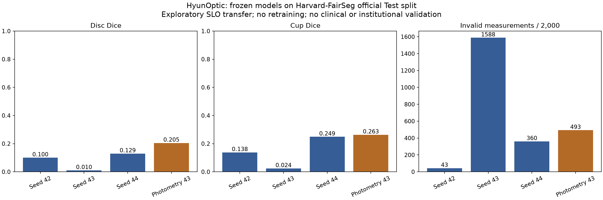

# University-data transfer tests — 2026-10-25

Actual local experiments show **poor transfer of the frozen color-fundus models to Harvard-FairSeg SLO images**. Broader photometry improves the seed43 comparator, but does not establish reliable SLO segmentation. All four original checkpoints and the default policy remain unchanged. No new training was performed for this experiment.

## What was actually tested

| Source | Actual scope | What the result means |
|---|---|---|
| Harvard-FairSeg | Official Test split, 2,000 images × four frozen models | Original-resolution disc/cup Dice and conditional pixel-span vCDR error |
| Georgia Tech OLIVES | 30 fundus-file archive-prefix pilot × four models | Execution/geometry availability only; **not** the full 1,268-image cohort or segmentation accuracy |
| Iowa INSPIRE-stereo | All 30 stereo TIFFs, both frames: 60 views × four models | Execution/geometry availability only; depth references are not OD/OC masks |
| Duke DME | All 10 MAT files, 610 image B-scans; manual layer references cover 110 B-scans | Re-analysis of **distributed automatic boundaries**, not HyunOptic inference or a newly trained OCT model |
| Columbia | Literature/code/access audit | No public download for the described patient dataset was verified; **no model test performed** |

These source names identify data or literature provenance. They do not imply institutional collaboration, endorsement, certification or clinical validation.

## Harvard-FairSeg: all 2,000 official Test cases

| Frozen model | Disc Dice | Cup Dice | Conditional vCDR MAE | MAE n | Invalid measurements |
|---|---:|---:|---:|---:|---:|
| baseline42 | 0.1003 | 0.1379 | 0.2586 | 1,957 | 43 |
| baseline43 | 0.0101 | 0.0237 | 0.3796 | 412 | 1,588 |
| baseline44 | 0.1291 | 0.2485 | 0.3592 | 1,640 | 360 |
| photometric43 | 0.2049 | 0.2630 | 0.2014 | 1,507 | 493 |

Disc/Cup Dice denominators are 2,000 for every model, including invalid-geometry predictions when masks exist. Reference failures: zero. Conditional MAE excludes undefined measurements and uses different subsets. On the **same 349 measurable cases**, baseline43/photometric43 MAE is **0.3753/0.1792**. This is a paired descriptive comparison, not evidence of adequate overall performance.

**A measurement can be geometrically valid and still localize the wrong structure.** In an additional descriptive audit, baseline42 has 1,345 geometrically measurable predictions with zero disc overlap; photometric43 has 302. These counts were derived after the fixed evaluation and are not new selection criteria or a validated reference-free detector. Full counts are in `results.json`.

Original uint8 grayscale SLO is replicated to RGB, without contrast stretching or target-derived cropping. Existing whole-image letterbox384, normalization, argmax and largest-disc postprocessing are preserved. Labels: 0 background, −1 rim, −2 cup; disc = rim ∪ cup. The official loader/helper confirms this mapping. Our vCDR is **vertical pixel-span ratio**; the FairSeg helper's CDR is an **area ratio**, so their error values are not interchangeable. The experiment does not isolate which modality, contrast, framing or other difference causes the poor transfer.

Official Test source files have identical 664×798 image/mask shapes, finite expected labels and no duplicate image-pixel arrays within this split. Each NPZ was checked against its publisher Hugging Face LFS SHA256 at revision `3c33b4e0ff8a864af9ce517879fca42e17688037`. We did **not** verify the full Zenodo ZIP MD5 or establish absence of cross-dataset patient overlap.

## Georgia Tech OLIVES: bounded pilot, no accuracy labels

| Model | Fundus files | Measurable | Invalid measurements |
|---|---:|---:|---:|
| baseline42 | 30 | 30 | 0 |
| baseline43 | 30 | 22 | 8 |
| baseline44 | 30 | 26 | 4 |
| photometric43 | 30 | 22 | 8 |

Selection was fixed before prediction: all complete fundus TIFF entries in the first 128 MiB of each inner archive's compressed stream (TREX-DME and PRIME). This yielded 14 and 16 files. The archive-order convenience sample contains repeated eyes/visits and filename variants from only two subject-level directories. No representative-population, independence or full-cohort claim is made. Exact HTTP byte ranges, extracted-entry CRC32 and local SHA256 were checked; **full outer ZIP MD5 was not checked**.

There are no OD/OC reference masks in this pilot. `reference_failed=0` means no failing reference was processed, not that references were available or valid. The public `evaluation_roles` explicitly records absent references. Measurability is not anatomical correctness.

## Iowa INSPIRE-stereo: all 60 original views

User completed official registration and supplied the source link; HTTPS delivered the **82,129,815-byte RAR**. Archive SHA256: `f5b5abb116a30f372587797d59c49f2bad93017632bf7c13e843e0a5da961579`. No publisher checksum was supplied; this is the preserved local archive hash, not independent source certification.

Each of 30 original RGB stereo TIFFs has two frames; all 60 views were tested. **All four models produced 60/60 geometrically measurable outputs. No Dice or vCDR accuracy was measured.** The 30 RGBA depth-reference visualizations were not converted into invented OD/OC masks or used as model inputs. The archive has 15 top-level grouping directories; independent patient count was not verified. Stereo views and repeated eyes are correlated.

## Duke DME: supplied-output boundary re-analysis

| Distributed output | Manual reader | Mean subject MAE (px) | Common points | Missing prediction points |
|---|---|---:|---:|---:|
| automaticLayersDME | 1 | 1.7023 | 451,159 | 9,782 |
| automaticLayersDME | 2 | 1.7630 | 449,327 | 9,777 |
| automaticLayersNormal | 1 | 3.9580 | 460,941 | 0 |
| automaticLayersNormal | 2 | 4.1749 | 459,104 | 0 |

All 10 MAT files and 610 image B-scans were read; manual references cover 110 B-scans. MAE is an unweighted mean of 10 subject-file means, using common finite in-bounds layer-boundary coordinates. Missing points were not imputed. Coverage differs, so lower conditional error alone does not establish superiority. This re-analysis is neither new PyTorch training nor independent validation of the original Duke algorithm. Original archive extraction/CRC checks passed; archive SHA256 is `c7ff12bdc1c1732f3cc694a3a23e1570d1ea5eb41203f727d20fcf3e4099d878`.

## Reproducibility, verification and limits

- [`results.json`](results.json), [`fairseg_metrics.csv`](fairseg_metrics.csv) and [`index.html`](index.html) contain aggregate results. Public role labels distinguish accuracy, geometry-only checks, distributed-output re-analysis and unavailable data.
- Original model hashes and runners were frozen before prediction and checked afterward. Six synthetic adapter tests passed. Separate review independently recomputed private-row means, medians, paired subsets, counts, case order and checkpoint hashes. These checks are not independent scientific certification.
- Inference used CUDA float32 batches8. In a one-image CPU/CUDA check, baseline42 differed by one postprocessed model-grid pixel; the other three models had zero postprocessed differences. This does not establish exhaustive backend equivalence. See `cpu_cuda_parity.json`.
- Original aggregate results, masks and model weights were not altered. No outcome-driven retries, further training or model promotion. No diagnostic, clinical-utility, fairness or established-robustness claim.
- [`REPRODUCE.md`](REPRODUCE.md) explains exact prerequisites and limitations. [`scripts/`](scripts/) preserves actual orchestration records. They are **not a standalone runnable model release**; original model bundles and some private intermediate files remain local.
- No source images, masks, patient identifiers/rows, registration details, screenshots or trained weights are included. `evidence_manifest.json` hashes every other file in this directory.
- Directory-local Git attributes preserve the exact evidence bytes across Windows/Linux checkouts. Publication verification checks the **staged Git blobs**, not only working files, against the manifest and frozen runner hashes.

## Sources and use conditions

- [Harvard-FairSeg official repository](https://github.com/Harvard-Ophthalmology-AI-Lab/FairSeg), [publisher HF mirror](https://huggingface.co/datasets/harvardairobotics/FairSeg), [Tian et al., ICLR 2024](https://openreview.net/pdf?id=qNrJJZAKI3). Noncommercial research only; source states CC BY-NC-ND 4.0, no patient-care use.
- [Georgia Tech OLIVES official page](https://alregib.ece.gatech.edu/olives-dataset/), [original distribution and paper citation](https://doi.org/10.5281/zenodo.7105232). Prabhushankar et al., NeurIPS Datasets and Benchmarks 2022. Review source data terms separately from code licensing.
- [Iowa INSPIRE official page and Tang et al. citation](https://eye.medicine.uiowa.edu/inspire-datasets), [HTTPS archive](https://webeye.ophth.uiowa.edu/abramoff/pamidataset.rar). Research/education access from the official provider; copying, redistribution and commercial use prohibited.
- [Duke DME official data and Chiu et al., BOE 2015 citation](https://people.duke.edu/~sf59/Chiu_BOE_2014_dataset.htm). Research/education only; commercialization/redistribution prohibited.
- [Columbia OCT report/eye-tracking paper](https://pmc.ncbi.nlm.nih.gov/articles/PMC11008801/), [related TCAV4OCT code](https://github.com/LIINC/TCAV4OCT). Code availability is not evidence of access to the paper's 185 patient OCT reports. No researcher was contacted.
