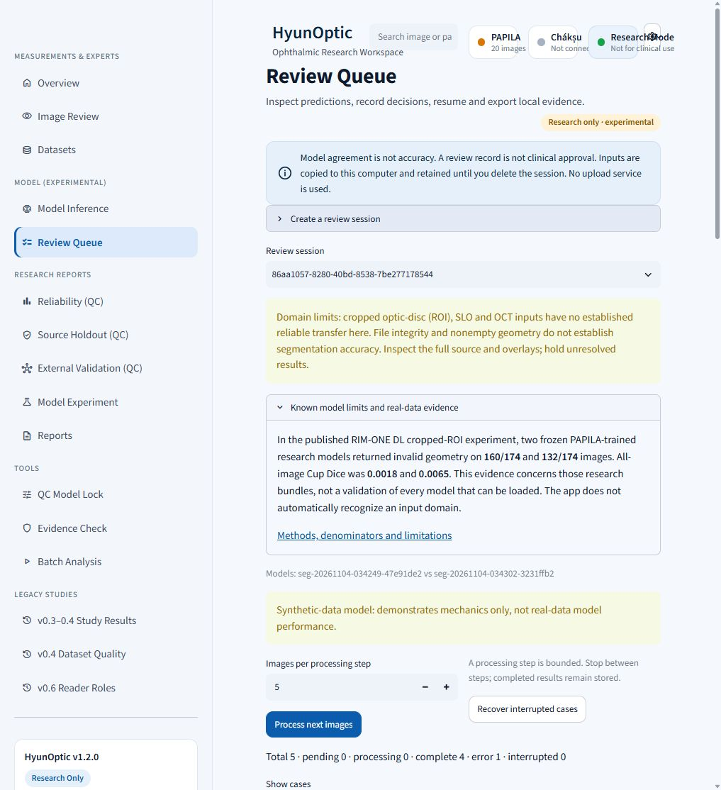
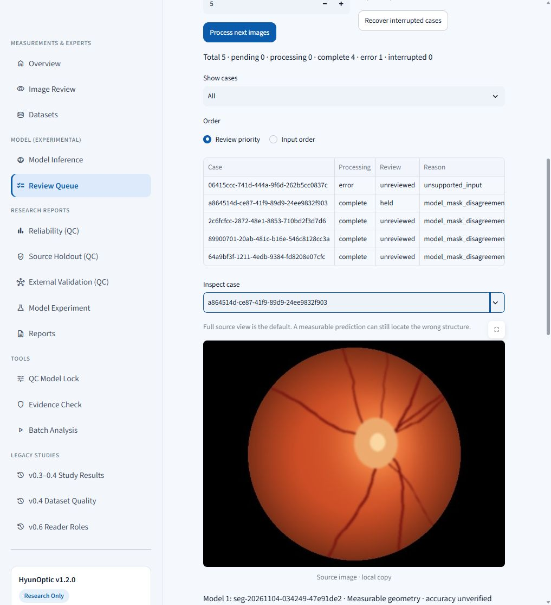

# Final submission polish and actual browser check

2026-11-04, pre-event. The existing research-review product is prepared with clearer reliance limits, current submission evidence and a new rendered-browser smoke check. This is not a Devpost submission or a claim of clinical readiness.

## Improvements completed

- Color-fundus sessions now keep cropped optic-disc (ROI), SLO and OCT transfer limits visible. Color input and valid file hashes do not imply domain compatibility.
- A compact evidence expander links the actual RIM-ONE DL failure results and explicitly distinguishes those two research models from any other loaded model. There is no automatic domain detector or new acceptance threshold.
- The displayed `ok` status is now **Measurable geometry · accuracy unverified**. Stored statuses, prediction/queue logic, decisions and model policy remain unchanged.
- The [description](../../submission/DEVPOST_DRAFT.md), [copy-ready fields](../../submission/SUBMISSION.md), [25-checkpoint rubric map](../../submission/RUBRIC_EVIDENCE.md), readiness and personal-review aids now distinguish historical 326/388-test audits from this final 390-test run. The 3,916-call real-data assessment and material negative outcomes are linked.

## Expected and observed browser behavior

The session was created through the project API in a new isolated workspace using the already verified public-source synthetic 80-epoch demo models. Creation itself was not repeated through browser uploads in this check; the earlier full browser-creation evidence remains in its original report. No patient data or private research weights entered this smoke check.

| Check | Expected | Observed |
| --- | --- | --- |
| Process next images | Four permitted synthetic images produce two predictions each; unreadable input retained | Four complete, eight predictions, one input error; all five cases remain |
| Domain limits | ROI warning remains visible for a color-fundus session; optional evidence is correctly scoped | Warning visible; expanded evidence shows 160/174 and 132/174 failures with research-bundle caveat |
| Measurement labels | Nonempty geometry does not appear as verified accuracy | Both models display accuracy-unverified geometry alongside vCDR |
| Held decision | Save held/uncertain, then full browser reload retains the record | One held/uncertain row persisted; store re-open independently confirmed it |
| Export | Build, verify and browser-download a privacy-filtered ZIP | Downloaded ZIP independently verified: six payloads, valid schema |

[Aggregate browser/store/download receipt](browser_receipt.json). These are workflow observations; the synthetic input count is not a medical sample or accuracy result.

## Verification

Two new UI regressions were first observed failing, then passed after the correction. The targeted interaction suite passed **11 tests in 16.27 seconds**. The final integrated suite passed **390 tests, two existing CUDA warnings, 225.52 seconds**. The warnings concern the existing CUDA nondeterministic loss kernel; no new test failed and no bitwise CUDA guarantee is made. [Software verification](software_verification.json).

The previous 130 experiment payloads across seven manifests and all 30 submission media payloads remain unchanged and verify. The older public 3:38 video truthfully shows its identified earlier version; this later source check does not retroactively replace that footage or claim a new video publication.

## Submission status

The runnable public-source synthetic route, description, rubric evidence, public video and source package are prepared. Current work is pre-event. The [official rules](https://global-ai-builders-challenge.devpost.com/rules), rechecked November 4, start the event **November 21 at 17:00 KST** and close submissions **November 29 at 08:00 KST**.

Genuine event-period contributions, the submitter's specific personal check/decision, actual roster/eligibility/rights confirmation and final Devpost links/embed/submission remain real human/event actions. Automated tests and agent review do not fabricate those. [Concrete personal worksheet](../../submission/HUMAN_REVIEW.md) · [final checklist](../../submission/CHECKLIST.md).

The A4 human-checking record is a quality checkpoint, not an extra eligibility condition or a blocker to technical preparation. [Independent final review](independent_review.json) found no open Critical, Important or Minor finding.
