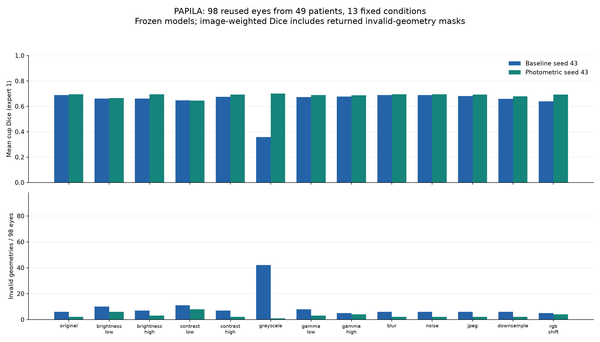
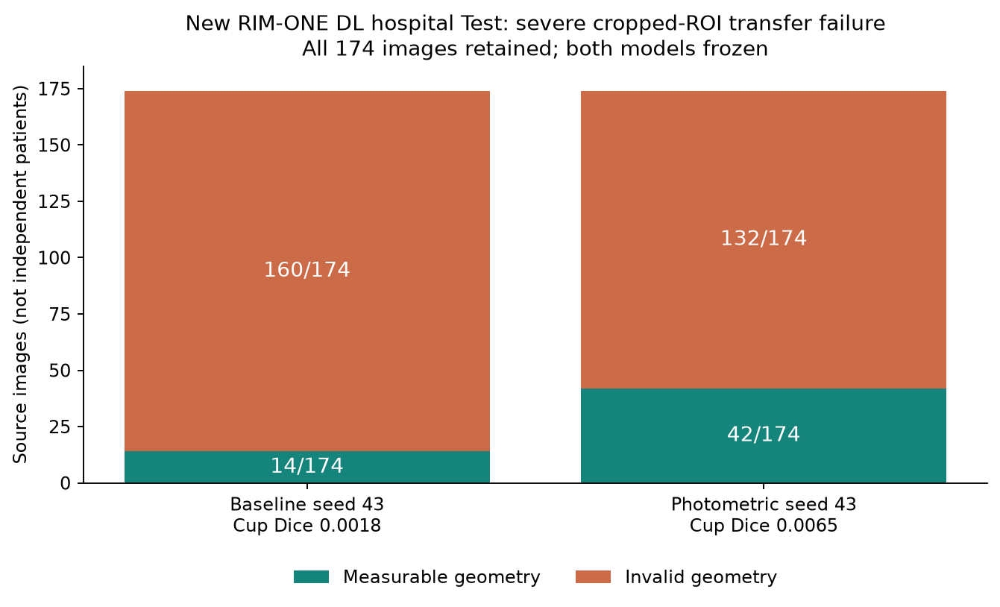

# Full real-data testing and reference-isolation fixes

2026-11-04, pre-event research audit. **The new external cropped-ROI test exposed severe transfer failure in both frozen models.** This work expands coverage beyond the earlier four-patient pilot, preserves negative outcomes, and fixes evaluator bugs. It does not establish clinical sufficiency or reproduce the 100 papers' original benchmarks.

## What was executed

| Dataset | Actual scope | New inference calls | Interpretation |
| --- | --- | ---: | --- |
| PAPILA | All 98 held-out eyes from 49 patients, 13 fixed conditions, two frozen models, both original readers | 2,548 | Reused internal Test cohort; transformations and eyes are correlated repeats |
| Chákṣu Test | All 336 images, two frozen models, five original experts and camera groups | 672 | Reused external Test cohort; reference failures isolated per expert |
| RIM-ONE DL | First project evaluation of all 174 official hospital-Test images; two complete two-model passes | 696 | 348 unique image-model pairs; repeated pass verifies artifacts, not new subjects |

Totals are **3,916 actual inference calls**, **3,568 distinct image-condition-model records within this audit**, and **608 source image records**. They are not 3,916 samples or 608 independent patients. Cross-dataset patient linkage was not verified. Only PAPILA has verified patient grouping here. [Execution accounting](execution_counts.json).

Both existing seed-43 models remained frozen. No training, target-label tuning, checkpoint selection, reference repair or default-policy promotion followed these Test results. Earlier public evidence, local model bundles and social-media drafts were not rewritten.

## 1. Full reused PAPILA holdout

[All condition results and both-reader denominators](papila/README.md) · [52 model/condition/reader aggregates, paired changes and intervals](papila/summary.json) · [protocol](papila/protocol.json).

The conditions cover original, two brightness levels, two contrast levels, grayscale, two gamma levels, blur, noise, JPEG compression, downsample/restore and RGB gains. These are our fixed strengths, not clinically calibrated severity or an original corruption benchmark. The 128-pixel downsample can substantially reduce detail. Geometry and reference coordinates remain unchanged.

All 2,548 masks were retained: 2,382 measurable predictions, 166 invalid geometries and zero execution errors. These are repeated predictions, not unique patient counts. In the grayscale condition, baseline Cup Dice fell from 0.6883 to 0.3581 and invalid geometries rose from 6/98 to 42/98. The photometric model had grayscale Cup Dice 0.7003 with 1/98 invalid. Converting the same photographs to grayscale does not validate transfer to SLO. The full 13-condition table prevents treating this selected descriptive example as the whole result; no policy was promoted.

All predictions and image-only priorities were saved before the new scoring phase interpreted expert contours. Source-content hashes and model identities were checked. Conditional vCDR error reports its denominator and exactly common original/condition eyes; equal-patient bootstrap estimates are separate from image-weighted means. [Independent complete artifact verification](papila/independent_verification.json) · [comparison with the earlier 196 original-only predictions](papila/original_crossrun_verification.json).

The independent verifier initially misread the wrapped split-manifest format before reaching metric checks. Its parser was corrected, canonical body hash checked, and the complete rerun passed without changing any prediction, reference or result. [Verification issue record](papila/verification_issues.json). This was a checker-input bug, not an additional product defect.



## 2. Fresh Chákṣu Test inference with five separate readers

[Detailed report](chaksu/REPORT.md) · [all-returned-mask results](chaksu/supplement_public_safe.json) · [original conditional vCDR analysis](chaksu/aggregate_public_safe.json).

All **672 original-resolution prediction masks** were returned and retained. Baseline had **18/336 invalid geometries**, photometric had **20/336**; execution exceptions were zero. Strict reference checks rejected **38 expert-image pairs across 25 images**, leaving **321/334/331/331/325** valid references for experts 1–5. These reference failures are separate from model failures and are not proof that the source annotations are clinically wrong.

All-returned-mask mean Cup Dice was **0.5734/0.5578/0.5431/0.5629/0.5477** for baseline and **0.5935/0.5673/0.5630/0.5651/0.5755** for photometric across the five experts. Dice includes invalid-geometry returned masks. vCDR MAE is conditional on valid prediction/reference geometry and uses different denominators; exactly common-case comparisons are reported separately.

The actual app queue was frozen before references. Its original vCDR event retains unknown measurements; a technical segmentation-event supplement was added **post hoc after partial reference inspection**, reporting all three thresholds and budgets without tuning. The five experts are correlated references. Image-IID intervals are descriptive sensitivity analyses because patient linkage is incomplete; they are not patient-independent population intervals.

On the legacy common 311 images, both statuses and every available historical expert-1/2 metric reproduced **exactly**. The earlier 25 reference-blocked images had no model inference. Old failure counts 16/19 among 311 and new 18/20 among 336 cannot be read as worsening. [Historical common-case check](chaksu/historical_commoncase_public_safe.json).

A fresh reviewer independently reproduced all **3,284 stored Dice-row aggregate calculations** and used a fixed **30-image, three-camera pixel audit** (60 prediction masks, 300 reference rasters, 286 valid model-reader Dice pairs). This is not a claim of independent raw-pixel recomputation of all 3,284 scores. [Verification](chaksu/chaksu_fresh_verification.json) · [independent queue arithmetic](chaksu/chaksu_queue_arithmetic.json).

## 3. New external RIM-ONE DL hospital Test: a material negative result

[Full report and source provenance](rimone/REPORT.md) · [original aggregates](rimone/aggregate.json) · [saved-mask repeat](rimone/supplemental_verification/aggregate.json).

| Frozen model | Disc Dice, all 174 | Cup Dice, all 174 | Invalid geometry | Conditional vCDR MAE (n) |
| --- | ---: | ---: | ---: | ---: |
| Baseline | 0.0122 | 0.0018 | 160/174 | 0.2185 (14) |
| Photometric | 0.0184 | 0.0065 | 132/174 | 0.2372 (42) |

The authors supply optic-nerve-head crops, a material domain difference from the whole-fundus training inputs. This experiment does not isolate the cause of failure. No new reference-derived crop was applied. The official hospital Test partition contains 118 normal-labelled and 56 glaucoma-labelled images; we evaluated segmentation, not disease classification or the original RIM-only-trained leaderboard.

The first pass pre-audited references and saved metrics, not masks. It was not label-blind. An explicitly exploratory second complete pass saved **348 original-resolution masks** and image-only priorities before re-scoring. All first/second statuses, errors and metrics matched exactly; first-pass pixel identity cannot be checked because those rasters were not saved. A separate reviewer verified all saved masks and **all 348 PNG/TXT reference pairs, including 5,568 contour points**, supporting polarity and coordinate interpretation. [Independent full-cohort check](rimone/rim_independent_verification.json).

The unpaired vCDR means use 14 versus 42 images and cannot rank the models. Only **two** eyes are common and measurable: MAE 0.1583 versus 0.1489, too small for a superiority claim. [Paired comparison](rimone/rim_paired_comparison.json).

The queue marked 172/174 cases invalid; the remaining two both-models-measurable cases also failed the technical event definition. All 174 events were positive at thresholds 0.4/0.5/0.6, so detection at every budget equalled random expectation. This saturated endpoint establishes **no triage benefit**. A measurable result is still not necessarily a correct result.



## 4. Reproduced software bugs and validation

| Defect | Correction | Observed failing regressions |
| --- | --- | ---: |
| One failed expert could prevent/overwrite the image prediction and other valid references | Predict from images first; score experts independently, preserve prediction status and report reference failures separately | 5 |
| A missing expert file removed the original image from model evaluation | Opt-in incomplete-reference indexing for model evaluation; original strict scanner default and complete-case manifest counts retained | 1 |
| A ZIP member CRC failure aborted the evaluator | Isolate `BadZipFile`/decompression failures at the reference or image boundary | 2 |

The final integrated suite passed **388 tests**, with two existing CUDA nondeterministic-kernel warnings, in **646.75 seconds**. Eight new regression cases are included; overlapping targeted checks are not added to the total. These tests verify software behavior, not clinical performance. [Software verification](software_verification.json). The CPU PyTorch CI job includes the new regressions.

Windows working-source byte hashes and Git's LF-normalized hashes are recorded separately; newline normalization and Python AST equality were checked. [Tested-source publication check](source_publication_verification.json). Frozen evidence payloads retain exact bytes across platforms.

Fresh whole-branch review found no open Critical, Important or Minor finding. Two reproduction/table-clarity issues were corrected. [Final scoped review](final_review.json).

## 5. Literature, reproduction and limits

The [100-paper catalogue](../2026-11-04-literature-100/papers.csv) remains the prior screening record, not 100 author-model reproductions. [Literature-to-test and reporting scope](reporting_scope.md) explains how CLAIM, dataset-shift/corruption work and the original data papers inform these checks. The RIM-ONE DL source paper and official conversion code were additionally inspected. There is no CLAIM certification or new probability-calibration claim.

```powershell
.venv/Scripts/python.exe docs/experiments/2026-11-04-full-real-validation/run_full_holdout.py --output reports/papila_full_fresh
.venv/Scripts/python.exe docs/experiments/2026-11-04-full-real-validation/papila/verify_full.py --input reports/papila_full_fresh --output reports/papila_full_fresh_check
.venv/Scripts/python.exe scripts/verify_experiment_evidence.py
```

The first two commands require permitted original PAPILA data and the exact private bundles. The source recipe identifies this experiment date; retain actual execution dates and identities for a later rerun. Additional data instructions: [Chákṣu](chaksu/PUBLIC_REPRODUCTION.md), [RIM-ONE DL](rimone/PUBLIC_REPRODUCTION.md). Historical crossrun checks require the preserved private historical outputs. Public aggregates alone cannot independently reconstruct patient-level results.

Only reviewed aggregate results, protocols/excerpts, source provenance, own-authored harnesses and aggregate plots are published. Raw images, source IDs, expert coordinates, prediction masks, private rows, archives and weights remain local. RIM-ONE DL source terms permit research/education and restrict redistribution/commercial use; no raw source material is republished.

This coverage can expose software and transfer failures; it is **not sufficient evidence for autonomous clinical measurements, diagnosis, calibrated abstention, clinician-time savings or deployment across devices/sites**. Prospective independently recruited evaluation and protected future Test data remain necessary for such claims. Repeatedly examined Test sets cannot become untouched confirmation again. The existing default training policy is retained.
