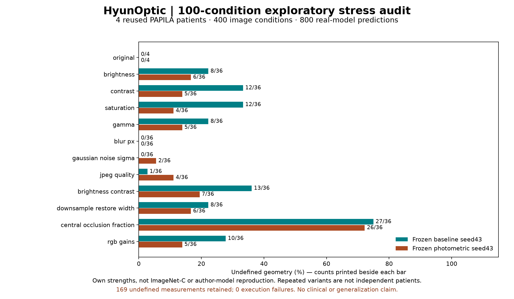

# 100-paper review, actual stress execution and contest-boundary fixes

2026-11-04, pre-event. Baseline source: `1d3c1b1`. This package combines **100 distinct papers**, an **own-model100-condition experiment**, and reproduced software defects. It does **not** claim100 author-model reproductions, a systematic review, a new independent patient cohort or clinical validation.

## What was actually completed

| Work | Actual scope |
| --- | --- |
| Literature | 100 unique DOI/arXiv/title keys, new to the scanned existing docs/README;99 original abstracts read and1 publisher-summary/guideline-passages exception |
| Deeper source inspection | Selected original full-text passages for10 records; not100 complete full-text reviews |
| Independent bibliographic check | 98 DOI/title pairs match Crossref publisher-deposited metadata;2 foundational arXiv papers checked against their original publication/preprint sources |
| Own-model execution | 100 predeclared image conditions ×4 previously evaluated PAPILA patients ×2 frozen models =800 new predictions |
| Observed outcomes | 631 measurable predictions;169 invalid-geometry results retained;0 execution failures;800 original-resolution masks preserved privately |
| Independent arithmetic/artifacts | All800 mask hashes/classes/geometries and200 aggregate rows checked; no failures; largest aggregate rounding difference1.11e−16 |
| Product remediation | Seven reproduced defect classes across numeric integrity, supplied splits, review budget/recovery and untrusted ZIP bounds |
| Original paper benchmarks | **0** reproduced. Original datasets/checkpoints/licenses were not presumed available from indexed links. |

## 1. Literature register and applicability

[CSV](papers.csv) · [JSON](papers.json) · [screening notes and actionable ten](papers_notes.md) · [queries](papers_query_log.json) · [exclusions](papers_exclusions.json) · [validation](papers_validation.json) · [summary](papers_summary.json) · [independent DOI/title checks](catalogue_verification.json).

The purposive topic counts are35 optic segmentation,25 domain robustness,10 annotation/multiple readers,20 uncertainty/calibration,8 reporting/metrics and2 general robustness foundations. Searches used original-index metadata and publication dates through November4. DOI/preprint keys and exact normalized titles were deduplicated; four similar-title pairs were manually retained as distinct works. Previously cited Chákṣu, CalDiff and Metrics Reloaded candidates were explicitly excluded. “New” means absent from that repository scan, not a worldwide originality claim. Indexed publication dates and retrieval failures remain visible.

Each record carries its source URL, screening level, original short relevance note, proposed test-family connection and author-model execution status. These connections are our methodological interpretation, not tests mandated or validated by each author. Multiple papers may motivate the same test family; they are not independent benchmark runs. P095 (CLAIM2024) lacks a conventional indexed abstract, so publisher summary/introduction/guideline passages were read. P079's publisher full-text access returned403 and remains abstract-level. Code/data links mentioned by authors are leads; destination access, license and usable checkpoints remain unverified unless separately recorded. No abstract collection or patient material is redistributed.

The [100-row execution-scope table](execution_scope.csv) links every record to actual checks or explicit evaluation limitations. It distinguishes previously executed reader analysis from this run and leaves author-model execution as not reproduced; a shared software check is not counted as100paper reproductions.

Examples directly informing the bounded audit include [Hendrycks & Dietterich, corruption/perturbation robustness](https://arxiv.org/abs/1903.12261) and [Ovadia et al., uncertainty under dataset shift](https://arxiv.org/abs/1906.02530), with medical-specific preprocessing, multi-rater, failure-detection, metric-pitfall and leakage papers listed in the register. This project has hard-label comparisons, not calibrated predictive probabilities; no ECE/Brier/NLL or uncertainty guarantee is invented.

## 2. Protocol frozen before inference

[Protocol](stress_protocol.json), SHA256`b06ea111f4d0a47994ace2f38d8a7c1d05534b7fcbc789dbb7ec7ba6a27bb449`, was written before prediction. The first lexicographic holdout image per patient was selected, taking the first four distinct patients—the same small reused cohort as the earlier pilot. No image was selected after seeing results. Baseline seed43 and photometric seed43 bundles remained frozen; all four existing real-data bundles also passed the stricter split checks without byte changes ([verification](real_bundle_verification.json)).

There are100 conditions: unchanged reference, then nine strengths each of brightness, contrast, saturation, gamma, blur, seeded Gaussian noise, JPEG compression, combined brightness/contrast, downsample/restore, central artificial occlusion and RGB gains. Exact values/seeds are in the protocol. Image dimensions and reference coordinates are unchanged. Occlusion intentionally changes visible anatomy; its masks are the unchanged original references, not new clinical annotations. The strengths are our exploratory choices, **not ImageNet-C, paper-specific settings or benchmark replication**.

The protocol records the working-tree inference/preprocessing source hashes as well as the baseline commit. Inference used the finite-logit boundary correction; baseline commit alone is not presented as an exact unmodified execution snapshot. All800 predictions were saved before expert1 contours were interpreted for scoring. Data content and bundle identities were checked before/after execution. There was no model training, checkpoint selection or policy promotion.

## 3. Actual outcomes and denominators

[All200 condition/model aggregates](stress_summary.json) · [model totals](stress_totals.json).

| Frozen model | Predictions | Measurable | Invalid geometry | Execution errors |
| --- | --- | --- | --- | --- |
| Baseline seed43 | 400 | 301 | 99 | 0 |
| Photometric seed43 | 400 | 330 | 70 | 0 |
| Total | 800 | 631 | 169 | 0 |

**Four patients remain four patients.** Conditions and two-model predictions are correlated repeats. These counts are not new clinical participants, a generalization estimate, or proof that one training policy should replace the default. The finite-output corrections do not repair transfer limitations. The original default training policy is retained.



Dice includes all four returned masks per condition/model, including empty predictions. vCDR MAE includes only measurable cases and reports its denominator; original-versus-condition comparisons additionally use exactly common measurable cases.

One concrete example: the photometric model's original vCDR MAE is**0.2133 (4 cases)**. At brightness×0.2 it appears lower at**0.0713 (2 cases)**, but the original MAE on those same two cases is**0.0273**—the paired error increased. A post-hoc descriptive scan found52 of200 condition/model rows with this direction reversal ([definition and example](posthoc_denominator_check.json)). This count is not a predeclared efficacy endpoint, independent evidence or significance test. It shows why a smaller conditional mean cannot be read alone.

Inference/transform/artifact wall time was571.55 seconds on this CPU setup; it excludes later reference scoring and independent verification. It is not an inference-only throughput benchmark or guaranteed runtime. [Independent verification](independent_numeric_verification.json) recalculated all631 available measurements (5,679 fields), all800 per-prediction overlaps/error states and all200 aggregate rows using separate arithmetic. Per-prediction differences were0; the largest aggregate difference was1.11e−16, within1e−12 tolerance. Existing contour loading/rasterization was reused, so this is not independent re-annotation.

## 4. Reproduced defects and corrections

| ID / priority | Before | Correction / regression |
| --- | --- | --- |
| F01 / P2 | NaN/Inf model logits could win argmax and produce `status=ok` with a plausible ratio | Reject nonfinite logits before labels/measurement; three invalid-logit regressions plus unchanged finite control |
| F02 / P2 | Numeric NaN/Inf masks became foreground during boolean conversion | Finite-value guards in shared measurement/Dice; nonzero integer-mask convention preserved |
| F03 / P2 | A correctly hashed supplied manifest could duplicate images or contradict declared patient partitions | Validate structure, duplicate/disjoint identifiers and parsable PAPILA eye-to-patient membership; existing generated splits remain unchanged |
| F04 / P2 | Separate training/evaluation Dice bypassed shared checks, accepting broadcast-compatible unequal shapes/nonfinite masks | Delegate to the shared guarded metric; eight observed failing entry-point regressions, valid scores unchanged |
| F05 / P1 | Forged ZIP declared size/CRC could hide a larger actual payload, bypassing expansion assumptions | Bound container/directory/compressed input and actual STORE/DEFLATE output, exact stream length/end/CRC, then hashes; reject unsupported codecs/ZIP64/multivolume |
| F06 / P2 | `ceil(100*0.07)` selected8 instead of7 because of binary floating point | Decimal-intent or exact-rational arithmetic; preserve genuinely above-boundary values; native Python integer results keep NumPy integer budgets JSON-serializable |
| F07 / P2 | An ancestor folder named`predictions` could cause recovery to quarantine a retained source input | Inspect session-relative path components; inputs survive such ancestor names and orphans still quarantine |

These are source/contract failures, not seven proven errors in prior clinical results. The split generator was not shown to leak data, normal bool masks did not acquire NaN, and patient data/bundles were not rewritten. ZIP malformed-input probes are bounded synthetic examples, not uncontrolled decompression bombs.

Regressions: [numeric/splits](../../../tests/test_literature_seg_boundaries.py), [shared training/evaluation Dice](../../../tests/test_literature_metric_consistency.py), [ZIP/recovery/budget](../../../tests/test_literature_review_boundaries.py). Failing pre-fix cases were observed before the corresponding corrections. An intermediate NumPy-import test-collection error was corrected and then two proper failing native-integer assertions were observed before the integer fix; it is not counted as a product defect.

The export schema now explicitly supports bounded, single-volume, non-ZIP64 STORE/DEFLATE packages; the project writer emits DEFLATE. Other ZIP codecs are rejected, not silently treated as supported. Independent compatibility checks accepted20 legitimate packages spanning both supported methods, streaming descriptors and chunk boundaries. Hashes still do not authenticate a maliciously replaced manifest or guarantee anonymity. Hostile manual edits to a trusted local database are outside this export-input boundary.

Final integrated local suite: **380 passed,2 existing CUDA nondeterministic-kernel warnings,371.98 seconds**. The previous public suite had326 tests;54 new regression cases are included. Counts from overlapping targeted runs are not added together. The final suite includes the two NumPy-integer cases added during integration; an earlier378-test run is not substituted for it. [Software/review verification](software_verification.json). The CPU CI job now includes the new torch-dependent boundary/metric regressions. Independent scoped code review found no outstanding Critical/Important/Minor issue; clinical generalization and author-model replication are outside that review conclusion.

## 5. Contest implications and remaining work

The [published rubric](https://global-ai-builders-challenge.devpost.com/resources) emphasizes demonstrated functionality/reliability as well as clear value and AI use. These fixes improve concrete failure handling and evidence fidelity. A count of papers, tests or transformations is not a contest score, novelty claim or substitute for the actual demonstration.

The public demo/preparation tag shows the earlier version truthfully; this later audit does not retroactively change its claims. Before freezing an entry, use the latest verified source and ensure the actual demo/description matches it. A genuine personal final check and actual event-period disclosure remain pending. No new clinically justified abstention threshold, calibration model, prospective review study or accessibility certification was introduced.

## 6. Reproduce within data permissions

Only aggregates, code, compact verification records and bibliographic notes are public. Original images, expert contours, individual identifiers, private rows and masks, local databases and weights remain private.

```powershell
# New output folders; requires authorized local PAPILA and the existing frozen bundles.
python docs/experiments/2026-11-04-literature-100/run_stress100.py --output reports/stress100_new
python docs/experiments/2026-11-04-literature-100/verify_stress100.py --report reports/stress100_new --output reports/stress100_independent_new.json
python scripts/verify_experiment_evidence.py
python -m pytest -q
```

The stress harness is tied to the declared PAPILA/frozen-bundle protocol. Renaming synthetic images into that layout does not create real-data evidence. Source and dataset restrictions still apply. Bibliographic checks verify identifiers/titles, not research quality or completeness of a paper's empirical claims.
