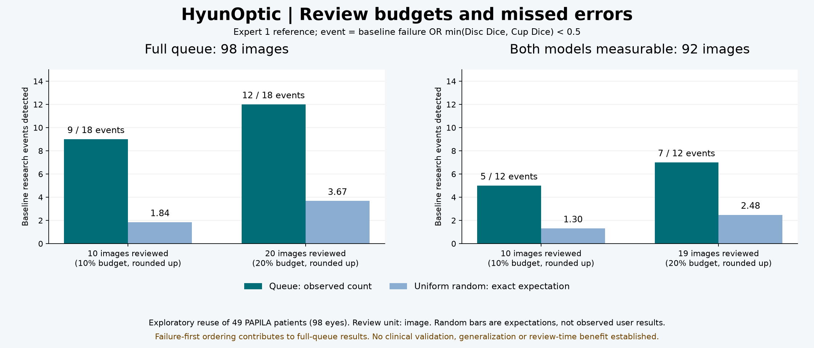

# 전문가 기준과 검토 순위의 실제 데이터 검증

2026-11-04. 기존 holdout을 다시 사용한 탐색적 평가다. 새 학습이나 독립 기관의 새 환자 자료 검증은 아니다. 기존 보고서·가중치는 수정하지 않았다.

## 무엇을 새로 실행했나

- **PAPILA holdout 전체 49명·98장**, 기존 baseline seed-43 및 photometric seed-43 고정 모델로 **새 예측 196개**를 생성했다. 변형 영상은 추가하지 않았다.
- bundle 전체 identity·가중치·동일 split·학습 당시 PAPILA content SHA256을 확인했다. protocol은 예측 전에 파일로 고정했다.
- 모든 예측을 로컬에 저장한 다음 전문가 1·2의 contour 좌표를 해석했다. 사전 content hash의 원본 바이트 읽기는 파일 무결성 확인용이다. 추론·검토 점수에는 전문가 주석이 들어가지 않는다.
- **Chákṣu 336장×두 모델의 보존된 10월 25일 기록**은 전문가 민감도만 재분석했다. 새 외부 추론이 아니다. 이 기록에는 이번 순위 계산에 필요한 원본 해상도 예측 mask가 없어, vCDR 차이로 mask 불일치를 대신하지 않았다.

실제 CPU 추론은 로그에 약 **171.1초**로 기록됐다. 저장·주석 평가·검증 시간을 포함한 전체 처리 시간이 아니며 속도 보장이 아니다. Python 3.12.10, PyTorch 2.13.0+cu126, CPU threads 4. 예측 시 reference crop이나 전문가 주석을 사용하지 않았다.

## 1. 전문가를 바꾸면 점수와 개별 모델 우열이 달라진다

아래 평균은 **영상 가중 평균**이다. Dice 분모는 실패한 빈 예측을 포함한 98장이다. vCDR MAE는 측정 가능한 영상만 포함하며 분모를 별도로 표시한다.

| 모델 | 기준 전문가 | Disc Dice (n=98) | Cup Dice (n=98) | vCDR MAE (n) | 모델 geometry 실패 |
| --- | --- | --- | --- | --- | --- |
| baseline-43 | 1, 학습 reader | 0.8936 | 0.6883 | 0.0728 (92) | 6 |
| baseline-43 | 2, 민감도 | 0.8716 | 0.6737 | 0.0757 (92) | 6 |
| photometric-43 | 1 | 0.9154 | 0.6939 | 0.0820 (96) | 2 |
| photometric-43 | 2 | 0.8948 | 0.6757 | 0.0832 (96) | 2 |

모델 실행 실패는 양쪽 0건이다. 두 전문가 모두 reference 98장이 평가 가능했고 geometry 경고는 0건이었다. 전문가 간 Cup Dice는 0.8220, 평균 절대 vCDR 차이는 0.0369였다. 이를 임상 정답이나 모델 성능의 상한으로 해석하지 않는다.

같은 98장에서 photometric − baseline Cup Dice 차이는 전문가 1 **+0.0056**, 전문가 2 **+0.0021**이다. 환자를 같은 가중치로 묶어 얻은 평균 차이의 95% percentile bootstrap 구간은 각각 **[-0.0178, 0.0301]**, **[-0.0202, 0.0273]**이다. 이 결과로 모델 우위를 확정하지 않는다. 개별 영상의 Cup Dice 모델 선호는 **23/98장**, Disc Dice는 **28/98장**에서 전문가를 바꾸면 뒤집혔다. 차이의 곱이 `-1e-12`보다 작은 경우만 flip으로 세었다.

JSON에는 영상 가중 평균과 **동일 환자 가중 bootstrap의 점 추정·구간**을 각각 저장한다. 두 눈이 모두 있으면 일치하지만, 일부 눈이 측정 불가하면 달라진다. 예를 들어 baseline/전문가1 vCDR MAE는 영상 평균 0.0728 (92눈), 환자 평균 **0.0790 (48명)**이고 환자 평균 구간은 **[0.0561, 0.1077]**이다. 영상 평균에 다른 estimand의 구간을 붙여 제시하지 않는다.

## 2. 고정 검토 예산에서 어떤 사례를 발견했나

연구용 event는 **baseline 예측 실패 또는 해당 전문가 기준 min(Disc Dice, Cup Dice)<0.5**다. 이는 녹내장 진단이나 임상 오류 기준이 아니다. 0.4·0.6 민감도도 JSON에 포함했다. 이 기준은 이전 파일럿과 연결된 탐색 조건이며, 결과를 보고 최적화하지 않았다.

순위는 앱과 동일하게 실행 오류 → invalid geometry → 모델 간 max(1−Disc Dice, 1−Cup Dice) 내림차순이다. 동점은 입력 ordinal 오름차순이다. 검토할 영상 수는 `ceil(예산×전체 영상 수)`다. 전문가 주석은 순위를 만든 뒤 event 평가에만 사용한다.

| 대상 | 기준 | 실제 검토 수 | 전체 event | 발견 / 놓침 | 균등 무작위 선택의 기대 발견 수 |
| --- | --- | --- | --- | --- | --- |
| 전체 98장, 10% | 전문가 1 | 10 | 18 | 9 / 9 | 1.8367 |
| 전체 98장, 20% | 전문가 1 | 20 | 18 | 12 / 6 | 3.6735 |
| 전체 98장, 10% | 전문가 2 | 10 | 19 | 9 / 10 | 1.9388 |
| 전체 98장, 20% | 전문가 2 | 20 | 19 | 12 / 7 | 3.8776 |
| 두 모델 geometry 정상 92장, 10% | 전문가 1 | 10 | 12 | 5 / 7 | 1.3043 |
| 두 모델 geometry 정상 92장, 20% | 전문가 1 | 19 | 12 | 7 / 5 | 2.4783 |
| 두 모델 geometry 정상 92장, 10% | 전문가 2 | 10 | 13 | 5 / 8 | 1.4130 |
| 두 모델 geometry 정상 92장, 20% | 전문가 2 | 19 | 13 | 7 / 6 | 2.6848 |

무작위 값은 실제 사용자의 관측치나 시뮬레이션 결과가 아니라, 동일한 유한 집합에서 k장을 균등 추출할 때의 정확한 기대값 `k×event 수/N`이다. 반복 샘플링에 따른 유의성이나 실제 검토 시간 절감은 검증하지 않았다. 전체 순위에는 이미 감지된 geometry 실패를 우선하는 효과가 들어가므로, 양쪽 모델이 측정 가능한 92장도 별도로 보고한다.

낮은 모델 불일치(≤0.1)인 51장에도 전문가 1 기준 event **1건**, 전문가 2 기준 **2건**이 있었다. 모델끼리 비슷한 예측을 한다고 오류가 배제되지 않는다. default 모델·학습 정책·임상 자동 보류 기준은 변경하지 않았다.



## 3. 외부 기록의 전문가 민감도 재분석

Chákṣu 전체 336개 기록 중 25개는 reference loading/geometry 문제로 점수가 없고, Dice 분모는 두 모델·두 전문가 모두 **311장**이다. 이 25개를 모델 실행 실패로 합산하지 않았다. 모델 geometry 실패는 baseline 16건, photometric 19건으로 이전 기록과 같다.

| 기준 전문가 | baseline Cup Dice | photometric Cup Dice | 차이 photo−baseline | 공통 284장의 vCDR MAE baseline → photo |
| --- | --- | --- | --- | --- |
| 1 | 0.5749 | 0.5915 | +0.0167 | 0.2553 → 0.1167 |
| 2 | 0.5646 | 0.5672 | +0.0026 | 0.2370 → 0.1148 |

개별 영상 Cup Dice 모델 선호는 **40/311장**, Disc Dice는 **49/311장**에서 reader를 바꾸면 뒤집혔다. 외부 영상 대부분의 환자 연결을 확인할 수 없어 환자 bootstrap 구간은 계산하지 않았다. 이 추가 분석이 과거 photometric 실험의 실패한 사전 성공 조건을 소급해 통과시키지 않는다.

## 4. 발견해 수정한 소프트웨어 문제

1. **동점 순위의 재현성:** UI가 무작위 UUID를 동점 기준으로 사용했다. 동일 영상을 다시 import하면 순서가 달라질 수 있어, 공유 `order_cases`와 입력 ordinal 동점 처리로 교체하고 새 session protocol v2에 기록했다. 동일 점수의 사례를 역순 UUID로 만든 UI 테스트가 수정 전 실패하고 수정 후 통과했다.
2. **해시 확인과 이미지 해석 사이의 파일 교체:** priority와 store가 파일 바이트를 해시한 뒤 경로를 다시 열었다. 제어된 교체 재현에서 실제 해시와 다른 mask로 불일치 점수 1.0이 계산됐다(정상 verified snapshot은 0.0). 이제 해시를 확인한 동일 메모리 바이트를 해석한다. store 검증 후 priority 단계에서 바뀐 파일이 발견돼도 integrity error로 처리하여 예측·파생 미리보기·검토 유효성을 차단한다. 현재 화면 이후의 모든 외부 파일 변경을 미리 막는다는 보장은 아니다.
3. **NumPy scalar 집계 저장 실패:** 새 실제 실험의 예측·ZIP 생성 후 summary JSON 작성이 `int64` 직렬화 오류로 실패했다. priority score를 Python float로 반환하고 연구 집계의 bool/count 경계를 명시했다. 실제 증상을 잡는 회귀 테스트가 수정 전 실패하고 수정 후 통과했다.

첫 실행의 모델 예측 196개·private row·ZIP은 유지했다. `--summarize-existing`으로 파일 무결성과 priority를 다시 확인한 뒤 집계를 복구했다. 새 추론은 하지 않았다. 이 aggregate 작성 실패는 연구 harness 실패이며 모델 실행 실패 0건과 구분한다. 후속 harness에는 scoring 직전에도 mask byte hash 확인을 추가했고, 보존 mask 전수 재계산으로 수치 일치 여부를 확인한다. 원래 protocol 바이트는 바꾸지 않았다.

검토 예산 유틸리티는 미확인 outcome을 false로 바꾸지 않고, 검토 예산의 전체 분모·실제 outcome 분모·누락 수를 따로 반환한다. 0%·100% 예산, event 0건, 부적절한 입력도 검사한다.

## 5. 논문과 연구 분야의 연결

- **Oxford Computer Science:** Fischer & Voiculescu, [The hidden value of uncertainty in medical segmentation](https://doi.org/10.3389/fimag.2026.1965816), 2026. 주석 선택에 따른 평가 민감도라는 문제를 실제 두-reader 분석으로 연결했다. Perspective이며 저자 알고리즘·데이터 성능 재현은 아니다. [OxMedIS 연구실](https://www.cs.ox.ac.uk/projects/OxMedIS/index.html).
- **Evidence-based healthcare 관련 방법론:** Collins et al., [TRIPOD+AI](https://doi.org/10.1136/bmj-2023-078378), 2024. 환자 단위, 자료 재사용, 실패 분모, 평가 목적 등 적용 가능한 보고 원칙을 참고했다. 진단·예후 확률 모델 전체 체크리스트를 통과했다는 주장은 아니다.
- **Translational health sciences 관련 방법론:** Greenhalgh 등의 [NASSS-CAT](https://www.phc.ox.ac.uk/research/groups-and-centres/interdisciplinary-research-in-health-sciences/enasss-cat). 실제 도입·사용자·조직 수준의 미검증 질문을 구분하는 참고 근거다. 코드에 넣어 성능을 시험한 알고리즘이 아니다.
- **의학·임상 전환 평가:** Vasey et al., [DECIDE-AI](https://doi.org/10.1136/bmj-2022-070904), 2022. 이번 offline 검사를 실제 사용자/임상 평가와 구분하는 근거다. 임상 workflow 연구를 수행하지 않았다.

위 분야는 DPhil 과정에 대한 연구 관심의 연결이며, 해당 과정이 데이터·모델을 제공하거나 결과를 승인했다는 뜻이 아니다. 이번 새 영상 추론은 PAPILA이고 Oxford 환자 자료를 새로 확보한 것은 아니다. 어제의 DDU·UMCT·CalDiff 코드/수식 검사를 오늘 새로 재실행한 것처럼 합산하지 않는다. 기관·저자 소속은 출처 설명이며 협업·후원·승인을 의미하지 않는다.

## 6. 증거와 재실행

- [protocol.json](protocol.json): 추론 전 고정한 원본 바이트.
- [summary.json](summary.json): 새 PAPILA 예측의 두-reader·순위 집계와 환자 bootstrap.
- [external_reanalysis.json](external_reanalysis.json): 보존된 외부 기록의 추가 집계.
- [mask_verification.json](mask_verification.json): 독립 픽셀 합계·occupied-row span으로 모든 보존 mask를 다시 계산한 결과.
- [run_validation.py](run_validation.py), [reanalyse_external.py](reanalyse_external.py), [verify_masks.py](verify_masks.py): 실행/복구/검증 코드. 초기 실행 후 위 저장 오류와 byte 검사 경계를 보완했으며, 원래 실패 로그는 로컬에 보존했다.

저자 의료 영상·전문가 contour·가중치·개별 식별자·로컬 DB·예측 mask·private row·ZIP은 공개하지 않는다. `manifest.json`은 공개 증거의 정확한 byte 길이와 SHA256을 기록한다.

```powershell
python docs/experiments/2026-11-04-reader-review-validation/run_validation.py --output reports/reader_review_fresh
python docs/experiments/2026-11-04-reader-review-validation/reanalyse_external.py --output reports/external_reader_fresh.json
python docs/experiments/2026-11-04-reader-review-validation/verify_masks.py --report reports/reader_review_fresh --output reports/mask_check_fresh.json
```

실행에는 사용 권한이 있는 로컬 PAPILA 전체 자료와 기존 두 bundle이 필요하다. 새로운 빈 output 경로를 사용한다. 집계 저장만 실패했다면 같은 private report에 `--summarize-existing`을 사용하며 기존 summary는 덮어쓰지 않는다. 이미 평가한 holdout의 재사용임을 항상 유지한다.

보존 mask **196개 SHA256**과 독립적인 수치 비교 **1,456개**가 통과했고 최대 수치 차이는 **0.0**이었다. 실험 후 PAPILA content hash도 사전 값과 같았다. 독립 검토는 private row 기준 budget·평균·paired change·환자 가중 bootstrap/구간 **990개 비교**, 외부 기록 **36개 scalar 비교** 및 protocol hash를 확인했다. 미해결 Critical/Important 결함은 없었고, 영상 평균과 환자 평균의 구분 및 첫 집계 실패 기록을 이 보고서에 반영했다.

최종 전체 제품 테스트는 **308 passed, 2 warnings, 213.21초**였다. 두 경고는 기존 CUDA 비결정적 kernel 관련이며 임상 검증을 뜻하지 않는다. [최신 소프트웨어 검증 기록](../../submission/VALIDATION.md)에도 이 실행을 추가했다.
