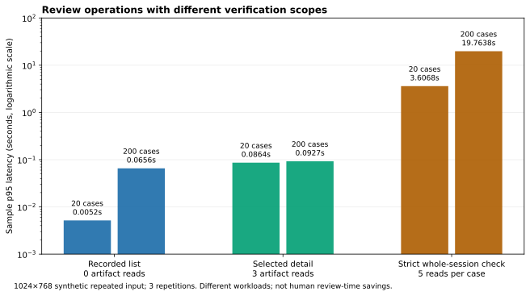

# Review workflow usability — 2026-11-04

**Software verification and implementation audit; browser acceptance is incomplete.** Baseline `870109d1a9566cd7d153eddb901cef963c4507d0`. This implements the [reviewed design](../../superpowers/specs/2026-11-04-review-usability-design.md) in response to an independent audit. All work is pre-event. It is not a claim of organizer acceptance, clinical benefit, a new public video or a completed personal A4 check.

## Implemented and tested boundaries

- Deletion consent resets on each session transition, including A → B → A, and deletion errors preserve the active session.
- Git provenance is bound to the exact application's checkout, never the caller's cwd, an outer repository, inherited Git overrides or an unbound CI SHA. Missing Git, failure or timeout returns unknown; wheel execution remains supported. New sessions retain the software version; legacy missing versions export as unknown, without relabeling historical records.
- Unsupported inputs show one terminal explanation and no futile retry; supported operational failures still allow explicit retry. Integrity failures withhold previews/review controls.
- Queue metadata makes no artifact reads and says its state is last recorded, not freshly verified. Selected detail returns the exact verified source/mask byte snapshots. Save, processing and full export retain their strict verification. Priority is bound to prediction/protocol hashes; legacy records fall back to unverified metadata.
- Stable local case labels replace UUID-only navigation. Filenames are opt-in local display and remain excluded from export. Save-and-next advances only after success; stale saves retain selection; filtering and final-case behavior are covered.
- Source and both identified model overlays use comparison columns, with a full-size alternative. Missing primary predictions do not relabel the comparison model. Responsive header CSS wraps status text; actual narrow/zoom visual acceptance is still pending.
- README and the description explain the task, personal motivation, research limits and an explicit manual-method comparison. No human time saving is asserted. Rights remain unchanged, and historical branches/media remain preserved.

## Measured software evidence

Final installed-wheel CPU verification passed **442 tests** (two intentional corrupt-TIFF warnings, 682.09 seconds); the final targeted development group passed **80 tests** in 209.74 seconds. The earlier implementation phase passed 440 tests in both environments before the additive version-field change. Application source: [`a888e53`](https://github.com/HyunStudio/HyunOptic/tree/a888e5391c01b2e0ca47e5718bcc4c82f4191577). No suite totals are added together.

The frozen JSON receipts describe suite outcomes, exact normalized source hashes, installed-wheel/API verification and bounded synthetic benchmarks. Earlier 404-test and browser/video evidence remains historical and is not added to current totals.

The benchmark repeats one deterministic synthetic noise input and fixed masks across separate case records to isolate storage scaling. It is not 200 independent photos, patients or human reviewers. On 200 × 1024×768 cases (474,313,800 stored evidence bytes), metadata listing's sample p95 was 0.06559 s, strict full-session verification 19.76375 s, and one selected case 0.09271 s. The corresponding artifact reads were 0, 1,000 and 3. There were three repetitions: these are descriptive measurements on this machine, not a production latency guarantee. The workloads intentionally differ; metadata does not perform the full verification earlier listing performed. Selected and consequential actions remain strict.

The figure can be regenerated to a new output with `python docs/experiments/2026-11-04-review-usability/render_benchmark_chart.py --output reports/review-latency.svg` (optional Matplotlib required).

## Explicit unmet acceptance items

The current application opened in the actual browser and exposed the intended model/import controls. The IAB file-chooser event timed out. A Chrome fallback was then stopped by Computer Use because it could not determine the Windows browser URL confidently enough to enforce policy. No further browser or desktop input was attempted after the stop. This is a tooling boundary, not evidence that end-to-end UI acceptance passed.

Therefore **current end-to-end browser creation/import, responsive 390/768px, 200% zoom, keyboard-only QA, new actual UI captures, and refreshed demonstration video are not completed**. Streamlit AppTest and direct installed-package API tests do not substitute for those checks. Earlier browser/video artifacts retain their exact older-source scope. The [new storyboard and draft captions](../../submission/DEMO_REFRESH_PLAN.md) are preparation only. No new upload or current-version public video is claimed.

The [personal review worksheet](../../submission/HUMAN_REVIEW.md) remains genuinely uncompleted. Repository About/topics are suggested metadata below, not claimed changed through the GitHub website. No author software license is chosen on the author's behalf; [rights record](../../submission/REPOSITORY_RIGHTS.md). The official rules require truthful disclosure of existing work and actual event additions, not retaining known defects until the event starts. [Rules](https://global-ai-builders-challenge.devpost.com/rules), [rubric](https://global-ai-builders-challenge.devpost.com/resources), checked 2026-11-04.

Suggested About: `Local research workflow for comparing ophthalmic AI predictions, preserving review decisions and exporting verified evidence.` Suggested topics: `pytorch`, `medical-imaging`, `ophthalmology`, `research-software`, `reproducible-research`, `streamlit`.

## Reproduction

Install the documented extras, run `pytest -q`, and run `python scripts/benchmark_review_metadata.py --output reports/review-benchmark --width 1024 --height 768 --repeats 3`. The benchmark uses synthetic data and removes its own temporary store on completion. Public aggregate receipts contain no patient data, weights, session identifiers, notes or workstation paths.
