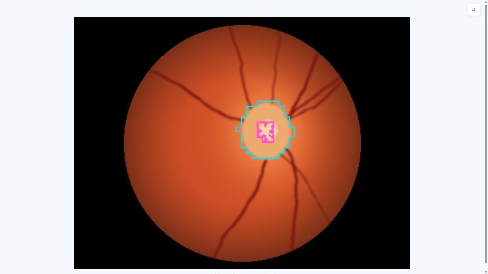
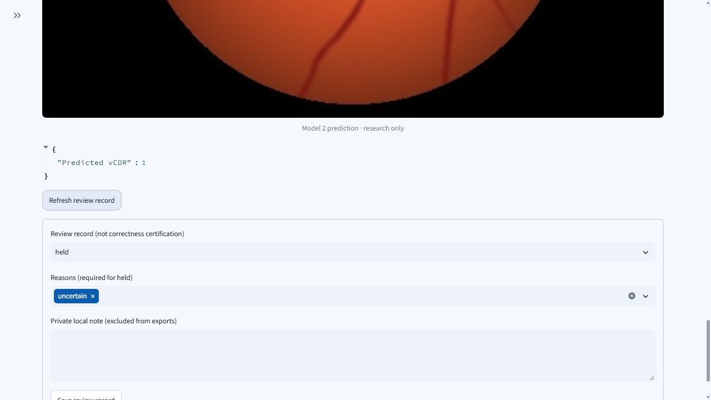

# Submission-readiness execution audit — 2026-11-04

The review workflow is locally demonstrated and the identified code defects are corrected. This is **pre-event preparation**, not a completed Devpost submission, a clinical evaluation, or proof of eligibility. See [readiness and remaining requirements](../../submission/READINESS.md).

## Source and environment

Implementation commits: `a93d8de` and `4948636`, following `3d59e88`. A separate local clone contained no private real-data bundles or datasets. Its source imports were explicitly checked and the final app ran from that clone at `4948636`. The installed Windows/Python 3.12.10 dependency environment was reused; this was not a fresh dependency installation. Optional dependencies and cross-platform installation are additionally exercised by CI.

The original documented two-epoch recipe actually trained two CPU models. On the same first four fixed synthetic images, seed 42 produced four measurable outputs and seed 43 produced four invalid-geometry outputs. A subsequent 20-epoch small-model recipe also retained that limitation. Neither failure was removed by choosing different images. The new preparation command uses 80 epochs, base channels 8 and learning rate 0.003, with the same seeds and fixed examples. Both models then produced measurable outputs on all four examples. This is an execution check only: no synthetic or clinical accuracy estimate is made.

[Synthetic setup and bundle identities](synthetic_setup.json) are preserved without weights or patient data. The generated cohort has ten synthetic patients/twenty synthetic eyes; the demo uses the first four images.

## Expected and observed workflow outcomes

All runs below used the default runner with actual verified PyTorch bundles, not a fake predictor.

| Check | Expected | Observed |
| --- | --- | --- |
| Browser create/process | 4 complete inputs, 8 predictions, 1 retained unreadable input | Matched |
| Browser hold/refresh | held + uncertain preserved | Matched |
| Browser download + separate CLI verification | valid ZIP, 6 payloads | Matched |
| Ordinary two-input run | 2 complete, 4 predictions, held survives reopened store | Matched |
| Repeat two-input run | Identical four prediction PNG digests | Matched |
| Demanding run, controlled interruption | 100 complete repeated cases + 1 unreadable input, 200 predictions; hold and verified export retained | Matched |
| Changed model bundle | First 2 completed cases and held decision preserved; remaining case visibly fails; export verifies | Matched |

The demanding run repeats four synthetic images; **100 cases are not 100 patients**. Interruption was a deliberately unfinished claim after three completed cases, followed by reopening and recovery; it was not an operating-system crash. Bundle failure was a hash mismatch in a separate copied model directory. The prepared demo models were not changed. Local ordinary/repeat/demanding wall times were 0.705/0.725/27.099 seconds, respectively; these are machine-specific execution observations, not user-time savings or a speed guarantee.

[Expected/actual checks](workflow_audit.json) and the [execution driver](run_workflow_audit.py) are public. Reproduce after preparing the demo, with a new output directory:

```powershell
python scripts/prepare_submission_demo.py --output demo_data/submission
python docs/experiments/2026-11-04-submission-readiness/run_workflow_audit.py reports/submission_workflow_run demo_data/submission
python -m hyunoptic.review.export reports/submission_workflow_run/demanding.zip
python scripts/verify_experiment_evidence.py
```

The audit driver deliberately changes only copied fault-model bytes. Do not point its output at an existing directory. Generated databases, input copies and ZIPs stay local.

## Defects fixed and verification

- Review Queue previously advertised Streamlit's 200 MB upload limit while enforcing 30 MB later. The form now communicates/enforces 30 MB and shows recognizable model folder names beside run IDs.
- Preview verification could check one file snapshot and later decode a replaced path. Input and label previews now decode the exact bytes whose digests were verified. New input/label replacement regressions first failed and now pass.
- An unreadable image exposed an internal byte-buffer representation. New errors use an actionable format message and the table keeps the reason `unsupported_input`. Existing frozen evidence was not rewritten.
- A public-source preparation command now creates an isolated synthetic workspace and trains two actual CPU models without requiring private developer weights. Existing output directories are refused.
- CI now verifies subsequent experiment manifests as well as the historical university evidence. A separate CPU job actually trains/verifies synthetic bundles.

Final local suite: **326 passed, 2 existing CUDA nondeterministic-kernel warnings, 207.80 seconds**. The warnings do not promise bitwise CUDA reproducibility. Targeted preview/input/store/runner/export tests passed 72 checks. Independent scoped code review covered the preparation, manifest verifier, CI and upload/model-label changes at `a93d8de`, finding no Critical/Important issue. The later preview/error correction at `4948636` was validated by observed failing regressions and the full suite; it was not part of that independent review's scope.

## Demonstration evidence

These are actual application captures of synthetic execution, not mock interfaces:





A **180-second silent, captioned local draft** was assembled from actual browser screenshots. It uses edited stills and prepared synthetic models/data, explicitly labeled throughout. It is not a continuous interaction recording or a published video. [Storyboard](video_storyboard.json) preserves the captions. The local MP4 was fully decoded successfully. The submitter still needs to choose/record the final actual-use video, review it and provide a public URL. No patient images or third-party weights are distributed here.
